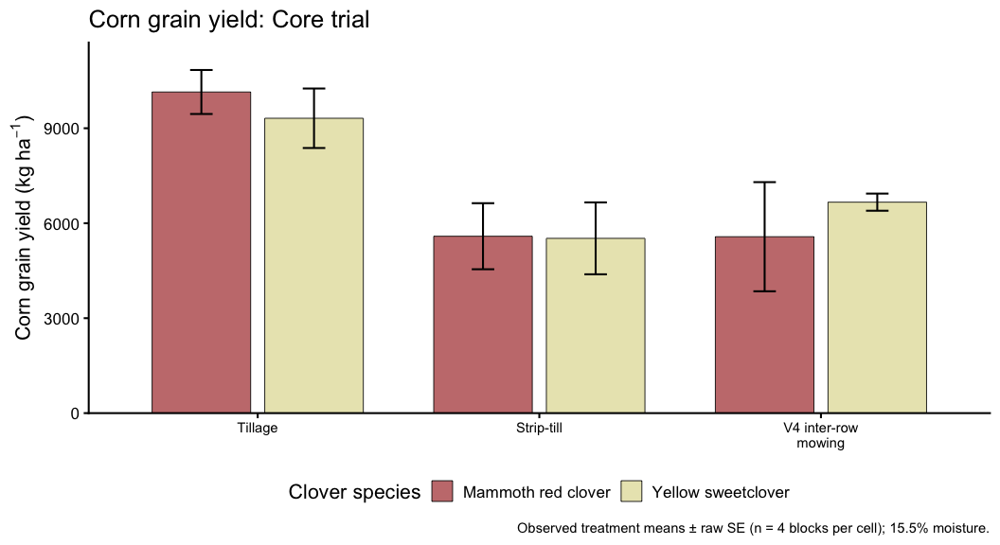
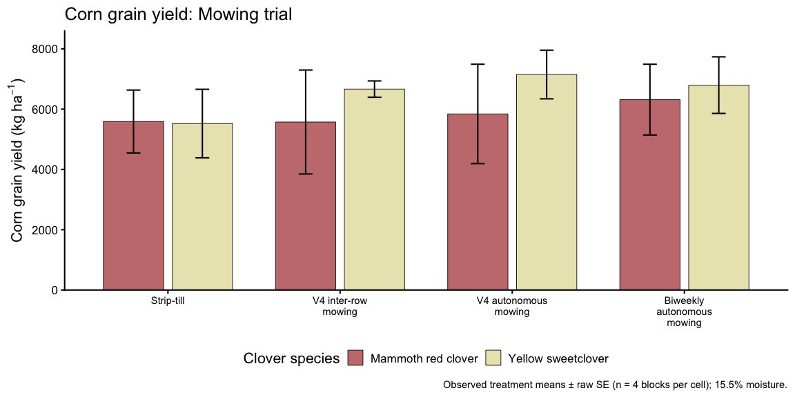
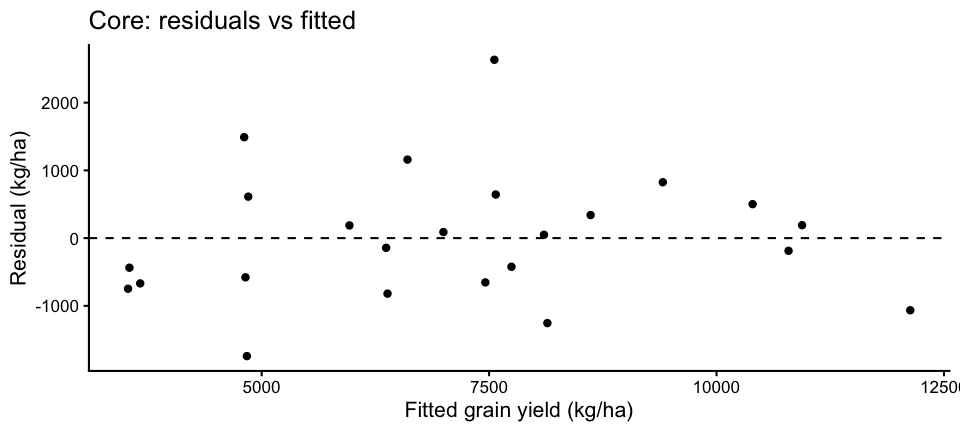
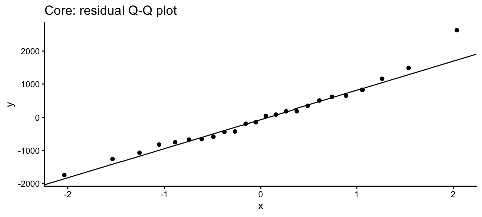
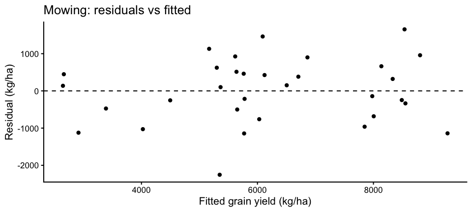
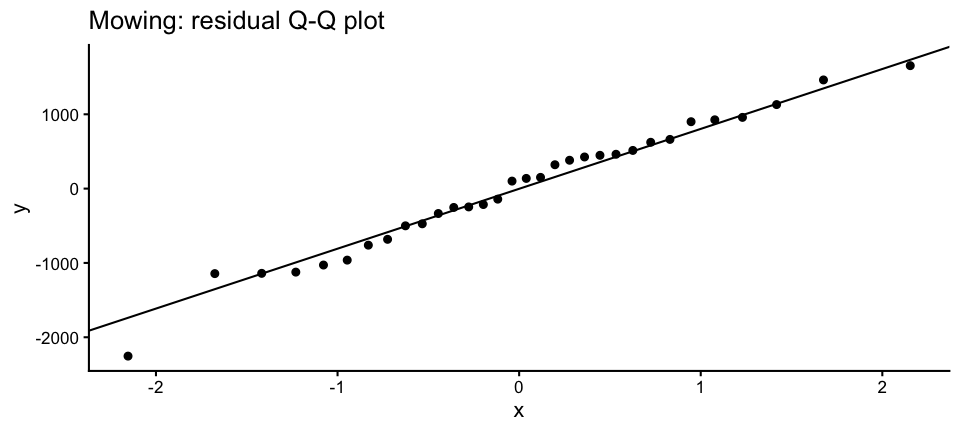

Yellow Mammoth: Corn Grain Yield (Musgrave 2026)
================
Sustainable Cropping Systems Lab
2026-11-05

- [Purpose and experimental design](#purpose-and-experimental-design)
- [Data import and validation](#data-import-and-validation)
- [Descriptive treatment summaries](#descriptive-treatment-summaries)
- [Descriptive figures](#descriptive-figures)
  - [Core trial: grain yield](#core-trial-grain-yield)
  - [Mowing trial: grain yield](#mowing-trial-grain-yield)
- [Linear mixed models](#linear-mixed-models)
  - [Core trial: model and ANOVA](#core-trial-model-and-anova)
  - [Core trial: diagnostics](#core-trial-diagnostics)
  - [Mowing trial: model and ANOVA](#mowing-trial-model-and-anova)
  - [Mowing trial: diagnostics](#mowing-trial-diagnostics)
- [Model-estimated means and post-hoc
  comparisons](#model-estimated-means-and-post-hoc-comparisons)
  - [Core trial: estimated means and
    comparisons](#core-trial-estimated-means-and-comparisons)
  - [Mowing trial: estimated means and
    comparisons](#mowing-trial-estimated-means-and-comparisons)
- [Preliminary interpretation](#preliminary-interpretation)

## Purpose and experimental design

Corn grain yield was measured at Musgrave Research Farm in 2026 in a
split-plot randomized complete block design with four blocks. Clover
species (mammoth red clover and yellow sweetclover) was assigned to
whole plots; management was assigned to subplots. The **core trial**
compares Tillage, Strip-till, and V4 inter-row mowing. The **mowing
trial** compares four strip-till treatments: Strip-till, V4 inter-row
mowing, V4 autonomous mowing, and Biweekly autonomous mowing (beginning
at V4 and continuing every two weeks through VT).

These two analyses share the Strip-till and V4 inter-row mowing
observations; they are complementary comparisons, **not independent
experiments**. Only Musgrave yield data are available at present. Grain
weights were recorded after shelling and subsequent oven drying to near
0% moisture. Yield is reported at 15.5% grain moisture, primarily in kg
ha^-1, with bu ac^-1 for reference.

## Data import and validation

Four 8.75-ft harvest transects per subplot, each in a 30-in row,
represent 87.5 ft^2. Oven-dry grain weight is converted to dry yield per
hectare, divided by 0.845 for yield at 15.5% moisture, and converted to
bu ac^-1 using 56 lb bu^-1 for shelled corn. The source data were
processed previously; these calculations are checked here, not
recomputed as analysis variables.

``` r
path <- here("data", "processed", "combined_processed.rds")
stopifnot(file.exists(path))
dat <- readRDS(path)
required <- c("location", "block_id", "whole_plot_id", "plot_id",
              "clover_species", "management", "grain_weight_g",
              "grain_yield_dry_kg_ha", "grain_yield_kg_ha",
              "grain_yield_bu_ac")
if (length(missing_columns <- setdiff(required, names(dat))))
  stop("Missing columns: ", paste(missing_columns, collapse = ", "))

musgrave <- dat |>
  filter(as.character(location) == "musgrave") |>
  mutate(clover_species = factor(as.character(clover_species),
                                 levels = names(species_colors)),
         management = factor(dplyr::recode(as.character(management),
                   "Between-row autonomous mowing" = "Biweekly autonomous mowing"),
                   levels = all_levels),
         block_id = factor(block_id),
         whole_plot_id = factor(whole_plot_id))

if (nrow(musgrave) != 40 || anyDuplicated(musgrave$plot_id))
  stop("Expected 40 unique Musgrave subplot records")
if (anyNA(musgrave[required])) stop("Missing design or yield values at Musgrave")
if (anyNA(musgrave[c("clover_species", "management")]))
  stop("Unrecognized treatment level")
yield_columns <- c("grain_weight_g", "grain_yield_dry_kg_ha",
                   "grain_yield_kg_ha", "grain_yield_bu_ac")
if (any(!is.finite(as.matrix(musgrave[yield_columns]))) ||
    any(as.matrix(musgrave[yield_columns]) <= 0))
  stop("Missing, nonfinite or nonpositive grain yield or grain weight")

design <- musgrave |>
  group_by(block_id, clover_species, whole_plot_id) |>
  summarise(n_subplots = n(), n_treatments = n_distinct(management),
            .groups = "drop")
if (n_distinct(musgrave$block_id) != 4 || nrow(design) != 8 ||
    any(design$n_subplots != 5) || any(design$n_treatments != 5) ||
    any(design |> count(whole_plot_id) |> pull(n) != 1) ||
    any(musgrave |> count(block_id, management) |> pull(n) != 2))
  stop("Unexpected Musgrave split-plot assignment")

harvest_area_m2 <- 4 * 8.75 * 2.5 * 0.09290304
calculated_dry <- musgrave$grain_weight_g / 1000 / harvest_area_m2 * 10000
calculated_155 <- calculated_dry / (1 - 0.155)
calculated_bu_ac <- calculated_155 * 2.20462262185 /
  2.47105381467 / 56
if (!isTRUE(all.equal(musgrave$grain_yield_dry_kg_ha, calculated_dry,
                      tolerance = 1e-5)) ||
    !isTRUE(all.equal(musgrave$grain_yield_kg_ha, calculated_155,
                      tolerance = 1e-5)) ||
    !isTRUE(all.equal(musgrave$grain_yield_bu_ac, calculated_bu_ac,
                      tolerance = 1e-5)))
  stop("Yield conversions do not agree with oven-dry grain weight")

core <- musgrave |>
  filter(management %in% core_levels) |>
  mutate(management = factor(as.character(management), levels = core_levels))
mowing <- musgrave |>
  filter(management %in% mowing_levels) |>
  mutate(management = factor(as.character(management), levels = mowing_levels))
stopifnot(nrow(core) == 24, nrow(mowing) == 32,
          n_distinct(core$whole_plot_id) == 8,
          n_distinct(mowing$whole_plot_id) == 8)
knitr::kable(design, caption = "Musgrave whole-plot design check")
```

| block_id | clover_species | whole_plot_id | n_subplots | n_treatments |
|:---|:---|:---|---:|---:|
| musgrave_2026_1 | Mammoth red clover | musgrave_2026_1_MRC | 5 | 5 |
| musgrave_2026_1 | Yellow sweetclover | musgrave_2026_1_YBSC | 5 | 5 |
| musgrave_2026_2 | Mammoth red clover | musgrave_2026_2_MRC | 5 | 5 |
| musgrave_2026_2 | Yellow sweetclover | musgrave_2026_2_YBSC | 5 | 5 |
| musgrave_2026_3 | Mammoth red clover | musgrave_2026_3_MRC | 5 | 5 |
| musgrave_2026_3 | Yellow sweetclover | musgrave_2026_3_YBSC | 5 | 5 |
| musgrave_2026_4 | Mammoth red clover | musgrave_2026_4_MRC | 5 | 5 |
| musgrave_2026_4 | Yellow sweetclover | musgrave_2026_4_YBSC | 5 | 5 |

Musgrave whole-plot design check

``` r
write_table(design, "musgrave_yield_design.csv")
```

## Descriptive treatment summaries

Tables and figures report **observed means ± raw standard errors**, with
four blocks contributing one observation to each species × management
combination. These are not model-estimated means.

``` r
summarise_yield <- function(x) {
  x |>
    group_by(clover_species, management) |>
    summarise(n = n(), mean_kg_ha = mean(grain_yield_kg_ha),
              sd_kg_ha = sd(grain_yield_kg_ha),
              se_kg_ha = sd_kg_ha / sqrt(n),
              mean_bu_ac = mean(grain_yield_bu_ac),
              se_bu_ac = sd(grain_yield_bu_ac) / sqrt(n),
              .groups = "drop")
}
core_summary <- summarise_yield(core)
mowing_summary <- summarise_yield(mowing)
knitr::kable(core_summary, digits = 1,
             caption = "Core trial: raw corn grain yield means and SE")
```

| clover_species | management | n | mean_kg_ha | sd_kg_ha | se_kg_ha | mean_bu_ac | se_bu_ac |
|:---|:---|---:|---:|---:|---:|---:|---:|
| Mammoth red clover | Tillage | 4 | 10145.6 | 1389.9 | 694.9 | 161.6 | 11.1 |
| Mammoth red clover | Strip-till | 4 | 5588.9 | 2087.1 | 1043.5 | 89.0 | 16.6 |
| Mammoth red clover | V4 inter-row mowing | 4 | 5573.6 | 3448.2 | 1724.1 | 88.8 | 27.5 |
| Yellow sweetclover | Tillage | 4 | 9315.7 | 1879.7 | 939.9 | 148.4 | 15.0 |
| Yellow sweetclover | Strip-till | 4 | 5521.9 | 2272.0 | 1136.0 | 88.0 | 18.1 |
| Yellow sweetclover | V4 inter-row mowing | 4 | 6664.7 | 541.3 | 270.7 | 106.2 | 4.3 |

Core trial: raw corn grain yield means and SE

``` r
knitr::kable(mowing_summary, digits = 1,
             caption = "Mowing trial: raw corn grain yield means and SE")
```

| clover_species | management | n | mean_kg_ha | sd_kg_ha | se_kg_ha | mean_bu_ac | se_bu_ac |
|:---|:---|---:|---:|---:|---:|---:|---:|
| Mammoth red clover | Strip-till | 4 | 5588.9 | 2087.1 | 1043.5 | 89.0 | 16.6 |
| Mammoth red clover | V4 inter-row mowing | 4 | 5573.6 | 3448.2 | 1724.1 | 88.8 | 27.5 |
| Mammoth red clover | V4 autonomous mowing | 4 | 5841.4 | 3296.6 | 1648.3 | 93.1 | 26.3 |
| Mammoth red clover | Biweekly autonomous mowing | 4 | 6315.3 | 2347.7 | 1173.8 | 100.6 | 18.7 |
| Yellow sweetclover | Strip-till | 4 | 5521.9 | 2272.0 | 1136.0 | 88.0 | 18.1 |
| Yellow sweetclover | V4 inter-row mowing | 4 | 6664.7 | 541.3 | 270.7 | 106.2 | 4.3 |
| Yellow sweetclover | V4 autonomous mowing | 4 | 7148.8 | 1613.9 | 806.9 | 113.9 | 12.9 |
| Yellow sweetclover | Biweekly autonomous mowing | 4 | 6796.5 | 1876.8 | 938.4 | 108.3 | 15.0 |

Mowing trial: raw corn grain yield means and SE

``` r
write_table(core_summary, "core_grain_yield_means.csv")
write_table(mowing_summary, "mowing_grain_yield_means.csv")
```

## Descriptive figures

The panels use the established clover colors and show raw means ± SE.
Management labels remain horizontal. Statistical letters, if warranted,
are reported separately with model-based comparisons rather than
overlaid on raw descriptive summaries.

### Core trial: grain yield

``` r
core_fig <- yield_figure(core_summary, "Corn grain yield: Core trial")
print(core_fig)
```

<!-- -->

``` r
save_figure(core_fig, "core_grain_yield.png", 11, 6)
```

### Mowing trial: grain yield

``` r
mowing_fig <- yield_figure(mowing_summary, "Corn grain yield: Mowing trial")
print(mowing_fig)
```

<!-- -->

``` r
save_figure(mowing_fig, "mowing_grain_yield.png", 12, 6)
```

## Linear mixed models

Initial models are Gaussian LMMs on untransformed grain yield (kg
ha^-1). Species, management, and their interaction are fixed; block and
the clover whole plot within block are random intercepts.
`whole_plot_id` is unique across blocks, so
`(1 | block_id) + (1 | whole_plot_id)` encodes the intended nesting.
Sum-to-zero contrasts support Type III tests with the interaction
included. No covariates or alternative distributions are considered
unless diagnostics indicate a need.

### Core trial: model and ANOVA

``` r
core_model <- fit_yield_model(core)
core_anova <- anova_table(core_model)
knitr::kable(core_anova, digits = 4,
             caption = "Core trial: Type III ANOVA (Satterthwaite df)")
```

| effect                    |      Sum Sq |     Mean Sq | NumDF | DenDF | F value | Pr(\>F) |
|:--------------------------|------------:|------------:|------:|------:|--------:|--------:|
| clover_species            |    17638.63 |    17638.63 |     1 |     3 |  0.0120 |  0.9196 |
| management                | 82116463.98 | 41058231.99 |     2 |    12 | 27.9795 |  0.0000 |
| clover_species:management |  3742100.87 |  1871050.44 |     2 |    12 |  1.2750 |  0.3147 |

Core trial: Type III ANOVA (Satterthwaite df)

``` r
write_table(core_anova, "core_yield_anova.csv")
cat("Singular fit:", lme4::isSingular(core_model), "\n")
```

    ## Singular fit: FALSE

``` r
print(summary(core_model))
```

    ## Linear mixed model fit by REML. t-tests use Satterthwaite's method [
    ## lmerModLmerTest]
    ## Formula: grain_yield_kg_ha ~ clover_species * management + (1 | block_id) +  
    ##     (1 | whole_plot_id)
    ##    Data: x
    ## 
    ## REML criterion at convergence: 332.3
    ## 
    ## Scaled residuals: 
    ##     Min      1Q  Median      3Q     Max 
    ## -1.4383 -0.5432 -0.0387  0.4368  2.1737 
    ## 
    ## Random effects:
    ##  Groups        Name        Variance Std.Dev.
    ##  whole_plot_id (Intercept)  209174   457.4  
    ##  block_id      (Intercept) 2851076  1688.5  
    ##  Residual                  1467438  1211.4  
    ## Number of obs: 24, groups:  whole_plot_id, 8; block_id, 4
    ## 
    ## Fixed effects:
    ##                             Estimate Std. Error       df t value Pr(>|t|)    
    ## (Intercept)                  7135.06     894.46     3.00   7.977 0.004111 ** 
    ## clover_species1               -32.39     295.45     3.00  -0.110 0.919620    
    ## management1                  2595.59     349.69    12.00   7.422 8.03e-06 ***
    ## management2                 -1579.68     349.69    12.00  -4.517 0.000705 ***
    ## clover_species1:management1   447.30     349.69    12.00   1.279 0.225040    
    ## clover_species1:management2    65.88     349.69    12.00   0.188 0.853727    
    ## ---
    ## Signif. codes:  0 '***' 0.001 '**' 0.01 '*' 0.05 '.' 0.1 ' ' 1
    ## 
    ## Correlation of Fixed Effects:
    ##             (Intr) clvr_1 mngmn1 mngmn2 cl_1:1
    ## clovr_spcs1  0.000                            
    ## management1  0.000  0.000                     
    ## management2  0.000  0.000 -0.500              
    ## clvr_spc1:1  0.000  0.000  0.000  0.000       
    ## clvr_spc1:2  0.000  0.000  0.000  0.000 -0.500

### Core trial: diagnostics

``` r
core_diag <- data.frame(fitted = fitted(core_model),
                        residual = resid(core_model))
p_core_resid <- ggplot(core_diag, aes(fitted, residual)) +
  geom_point(size = 2) + geom_hline(yintercept = 0, linetype = 2) +
  labs(x = "Fitted grain yield (kg/ha)", y = "Residual (kg/ha)",
       title = "Core: residuals vs fitted")
p_core_qq <- ggplot(core_diag, aes(sample = residual)) +
  stat_qq() + stat_qq_line() +
  labs(title = "Core: residual Q-Q plot")
print(p_core_resid)
```

<!-- -->

``` r
print(p_core_qq)
```

<!-- -->

``` r
save_figure(p_core_resid, "core_residuals.png", 7, 5)
save_figure(p_core_qq, "core_qq.png", 7, 5)
```

### Mowing trial: model and ANOVA

``` r
mowing_model <- fit_yield_model(mowing)
mowing_anova <- anova_table(mowing_model)
knitr::kable(mowing_anova, digits = 4,
             caption = "Mowing trial: Type III ANOVA (Satterthwaite df)")
```

| effect                    |    Sum Sq |   Mean Sq | NumDF | DenDF | F value | Pr(\>F) |
|:--------------------------|----------:|----------:|------:|------:|--------:|--------:|
| clover_species            |  703217.9 |  703217.9 |     1 |     3 |  0.5589 |  0.5090 |
| management                | 5075433.8 | 1691811.3 |     3 |    18 |  1.3445 |  0.2913 |
| clover_species:management | 2315832.8 |  771944.3 |     3 |    18 |  0.6135 |  0.6150 |

Mowing trial: Type III ANOVA (Satterthwaite df)

``` r
write_table(mowing_anova, "mowing_yield_anova.csv")
cat("Singular fit:", lme4::isSingular(mowing_model), "\n")
```

    ## Singular fit: FALSE

``` r
print(summary(mowing_model))
```

    ## Linear mixed model fit by REML. t-tests use Satterthwaite's method [
    ## lmerModLmerTest]
    ## Formula: grain_yield_kg_ha ~ clover_species * management + (1 | block_id) +  
    ##     (1 | whole_plot_id)
    ##    Data: x
    ## 
    ## REML criterion at convergence: 442
    ## 
    ## Scaled residuals: 
    ##     Min      1Q  Median      3Q     Max 
    ## -2.0091 -0.4868  0.1062  0.4824  1.4748 
    ## 
    ## Random effects:
    ##  Groups        Name        Variance Std.Dev.
    ##  whole_plot_id (Intercept) 1454839  1206    
    ##  block_id      (Intercept) 2812761  1677    
    ##  Residual                  1258301  1122    
    ## Number of obs: 32, groups:  whole_plot_id, 8; block_id, 4
    ## 
    ## Fixed effects:
    ##                             Estimate Std. Error      df t value Pr(>|t|)   
    ## (Intercept)                  6181.38     961.44    3.00   6.429  0.00763 **
    ## clover_species1              -351.58     470.29    3.00  -0.748  0.50898   
    ## management1                  -626.00     343.46   18.00  -1.823  0.08502 . 
    ## management2                   -62.24     343.46   18.00  -0.181  0.85823   
    ## management3                   313.73     343.46   18.00   0.913  0.37309   
    ## clover_species1:management1   385.06     343.46   18.00   1.121  0.27697   
    ## clover_species1:management2  -193.99     343.46   18.00  -0.565  0.57918   
    ## clover_species1:management3  -302.08     343.46   18.00  -0.880  0.39071   
    ## ---
    ## Signif. codes:  0 '***' 0.001 '**' 0.01 '*' 0.05 '.' 0.1 ' ' 1
    ## 
    ## Correlation of Fixed Effects:
    ##             (Intr) clvr_1 mngmn1 mngmn2 mngmn3 cl_1:1 cl_1:2
    ## clovr_spcs1  0.000                                          
    ## management1  0.000  0.000                                   
    ## management2  0.000  0.000 -0.333                            
    ## management3  0.000  0.000 -0.333 -0.333                     
    ## clvr_spc1:1  0.000  0.000  0.000  0.000  0.000              
    ## clvr_spc1:2  0.000  0.000  0.000  0.000  0.000 -0.333       
    ## clvr_spc1:3  0.000  0.000  0.000  0.000  0.000 -0.333 -0.333

### Mowing trial: diagnostics

``` r
mowing_diag <- data.frame(fitted = fitted(mowing_model),
                          residual = resid(mowing_model))
p_mowing_resid <- ggplot(mowing_diag, aes(fitted, residual)) +
  geom_point(size = 2) + geom_hline(yintercept = 0, linetype = 2) +
  labs(x = "Fitted grain yield (kg/ha)", y = "Residual (kg/ha)",
       title = "Mowing: residuals vs fitted")
p_mowing_qq <- ggplot(mowing_diag, aes(sample = residual)) +
  stat_qq() + stat_qq_line() +
  labs(title = "Mowing: residual Q-Q plot")
print(p_mowing_resid)
```

<!-- -->

``` r
print(p_mowing_qq)
```

<!-- -->

``` r
save_figure(p_mowing_resid, "mowing_residuals.png", 7, 5)
save_figure(p_mowing_qq, "mowing_qq.png", 7, 5)
```

## Model-estimated means and post-hoc comparisons

Model-based means are supplied for transparency, separately from the raw
figures. If the species × management interaction is significant at alpha
= 0.05, compare management treatments *within each species*. Otherwise,
compare the marginal management means only if the management main effect
is significant, and marginal species means only if the species main
effect is significant. Pairwise comparisons use **unadjusted Fisher’s
LSD-style p-values** (`adjust = "none"`), conditional on the relevant
omnibus test. These comparisons are exploratory, not
multiplicity-adjusted. Where comparisons are conducted, CLDs use
lowercase letters with `a` assigned to the highest model mean; shared
letters indicate that a difference was not detected, not equivalence.

### Core trial: estimated means and comparisons

``` r
report_emmeans(core_model, core_anova, "core")
```

    ## 
    ## 
    ## Table: core model-estimated species × management means
    ## 
    ## |clover_species     |management          |   emmean|      SE|  df| lower.CL| upper.CL|
    ## |:------------------|:-------------------|--------:|-------:|---:|--------:|--------:|
    ## |Mammoth red clover |Tillage             | 10145.55| 1063.92| 5.8|  7520.37| 12770.74|
    ## |Yellow sweetclover |Tillage             |  9315.74| 1063.92| 5.8|  6690.56| 11940.93|
    ## |Mammoth red clover |Strip-till          |  5588.86| 1063.92| 5.8|  2963.68|  8214.05|
    ## |Yellow sweetclover |Strip-till          |  5521.90| 1063.92| 5.8|  2896.71|  8147.08|
    ## |Mammoth red clover |V4 inter-row mowing |  5573.58| 1063.92| 5.8|  2948.39|  8198.76|
    ## |Yellow sweetclover |V4 inter-row mowing |  6664.71| 1063.92| 5.8|  4039.52|  9289.89|
    ## Species × management interaction not significant; examining marginal effects.

    ## 
    ## 
    ## Table: core management comparisons (unadjusted)
    ## 
    ## |contrast                             | estimate|      SE| df| t.ratio| p.value|
    ## |:------------------------------------|--------:|-------:|--:|-------:|-------:|
    ## |Tillage - (Strip-till)               | 4175.269| 605.689| 12|   6.893|    0.00|
    ## |Tillage - (V4 inter-row mowing)      | 3611.506| 605.689| 12|   5.963|    0.00|
    ## |(Strip-till) - (V4 inter-row mowing) | -563.763| 605.689| 12|  -0.931|    0.37|
    ## 
    ## 
    ## Table: core management LSD letter groupings
    ## 
    ## |   |management          |  emmean|     SE|   df| lower.CL| upper.CL|.group |
    ## |:--|:-------------------|-------:|------:|----:|--------:|--------:|:------|
    ## |2  |Tillage             | 9730.65| 960.39| 3.96|  7054.61| 12406.69|a      |
    ## |3  |V4 inter-row mowing | 6119.14| 960.39| 3.96|  3443.10|  8795.18|b      |
    ## |1  |Strip-till          | 5555.38| 960.39| 3.96|  2879.34|  8231.42|b      |
    ## Clover species main effect not significant.

### Mowing trial: estimated means and comparisons

``` r
report_emmeans(mowing_model, mowing_anova, "mowing")
```

    ## 
    ## 
    ## Table: mowing model-estimated species × management means
    ## 
    ## |clover_species     |management                 |  emmean|      SE|   df| lower.CL| upper.CL|
    ## |:------------------|:--------------------------|-------:|-------:|----:|--------:|--------:|
    ## |Mammoth red clover |Strip-till                 | 5588.86| 1175.36| 6.27|  2742.97|  8434.76|
    ## |Yellow sweetclover |Strip-till                 | 5521.90| 1175.36| 6.27|  2676.00|  8367.79|
    ## |Mammoth red clover |V4 inter-row mowing        | 5573.58| 1175.36| 6.27|  2727.68|  8419.47|
    ## |Yellow sweetclover |V4 inter-row mowing        | 6664.71| 1175.36| 6.27|  3818.81|  9510.60|
    ## |Mammoth red clover |V4 autonomous mowing       | 5841.45| 1175.36| 6.27|  2995.55|  8687.34|
    ## |Yellow sweetclover |V4 autonomous mowing       | 7148.77| 1175.36| 6.27|  4302.87|  9994.66|
    ## |Mammoth red clover |Biweekly autonomous mowing | 6315.31| 1175.36| 6.27|  3469.42|  9161.21|
    ## |Yellow sweetclover |Biweekly autonomous mowing | 6796.46| 1175.36| 6.27|  3950.56|  9642.35|
    ## Species × management interaction not significant; examining marginal effects.
    ## Management main effect not significant; no management post-hoc tests.
    ## Clover species main effect not significant.

## Preliminary interpretation

The figures present treatment means without inferential annotation.
Interpret the ANOVA and any model-based post-hoc comparisons only after
reviewing the diagnostic plots, checking convergence and singularity,
and confirming that the Gaussian error assumption is reasonable. With
one site-year, results apply to Musgrave 2026; additional site-years can
be incorporated in a subsequent analysis without altering this
preliminary record.
