Yellow Mammoth: Peak Weed Biomass and Legume Biomass
================
Sustainable Cropping Systems Lab
2026-11-05

- [Purpose and experimental design](#purpose-and-experimental-design)
- [Import and validation](#import-and-validation)
- [Descriptive treatment means](#descriptive-treatment-means)
- [Descriptive figures](#descriptive-figures)
  - [Core trial: peak weed biomass](#core-trial-peak-weed-biomass)
  - [Core trial: legume biomass](#core-trial-legume-biomass)
  - [Musgrave mowing trial: peak weed
    biomass](#musgrave-mowing-trial-peak-weed-biomass)
  - [Musgrave mowing trial: legume
    biomass](#musgrave-mowing-trial-legume-biomass)
- [Mixed models](#mixed-models)
- [Core trial: weed biomass](#core-trial-weed-biomass)
  - [Diagnostics](#diagnostics)
  - [ANOVA and within-location management
    comparisons](#anova-and-within-location-management-comparisons)
- [Core trial: legume biomass
  (preliminary)](#core-trial-legume-biomass-preliminary)
- [Musgrave mowing trial: weed biomass
  (preliminary)](#musgrave-mowing-trial-weed-biomass-preliminary)
- [Musgrave mowing trial: legume biomass
  (preliminary)](#musgrave-mowing-trial-legume-biomass-preliminary)
- [Interpretation notes](#interpretation-notes)
- [Session information](#session-information)

## Purpose and experimental design

Peak biomass was measured after management treatments were implemented
in a split-plot randomized complete block design (four blocks per
location). Clover species was assigned to whole plots and management to
subplots.

The **core trial** includes Tillage, Strip-till, and V4 inter-row mowing
at Musgrave and Farm Hub. The **Musgrave mowing trial** compares four
strip-till management treatments, excluding Tillage. Biweekly autonomous
mowing began at V4 and continued every two weeks through VT. These
analyses share observations and are not independent experiments. Spring
biomass is **not included**. Legume biomass was measured during peak
weed sampling, not necessarily at peak legume growth.

## Import and validation

``` r
path <- here("data", "processed", "combined_processed.rds")
stopifnot(file.exists(path))
dat <- readRDS(path)
required <- c("location", "block_id", "whole_plot_id", "plot_id",
              "clover_species", "management", "peak_weed_biomass_kg_ha",
              "peak_legume_biomass_kg_ha",
              "peak_weed_biomass_g_0_5m2_below_detection")
if (length(setdiff(required, names(dat))))
  stop("Missing fields: ", paste(setdiff(required, names(dat)), collapse = ", "))
if (anyDuplicated(dat$plot_id)) stop("Duplicate subplot identifiers")
if (anyNA(dat[required])) stop("Missing design or outcome values")
for (response in c("peak_weed_biomass_kg_ha", "peak_legume_biomass_kg_ha")) {
  if (any(!is.finite(dat[[response]]) | dat[[response]] < 0))
    stop("Invalid biomass values: ", response)
}

dat <- dat |>
  mutate(location = factor(as.character(location),
                           levels = c("farmhub", "musgrave"),
                           labels = c("Farm Hub", "Musgrave")),
         clover_species = factor(as.character(clover_species),
                                 levels = names(species_colors)),
         management = factor(dplyr::recode(as.character(management),
                    "Between-row autonomous mowing" = "Biweekly autonomous mowing"),
                    levels = all_levels),
         block_id = factor(block_id),
         whole_plot_id = factor(whole_plot_id))
if (anyNA(dat[c("location", "clover_species", "management")]))
  stop("Unrecognized treatment or location level")

design <- dat |>
  group_by(location, block_id, clover_species, whole_plot_id) |>
  summarise(n_subplots = n(), .groups = "drop")
if (nrow(design) != 16 ||
    any(design$n_subplots != ifelse(design$location == "Musgrave", 5, 3)) ||
    any(design |> count(whole_plot_id) |> pull(n) != 1))
  stop("Unexpected split-plot structure")
core <- dat |>
  filter(management %in% core_levels) |>
  mutate(management = droplevels(management),
         block_id = droplevels(block_id),
         whole_plot_id = droplevels(whole_plot_id))
tool <- dat |>
  filter(location == "Musgrave", management %in% mowing_levels) |>
  mutate(location = droplevels(location),
         management = droplevels(management),
         block_id = droplevels(block_id),
         whole_plot_id = droplevels(whole_plot_id))
stopifnot(nrow(core) == 48, nrow(tool) == 32,
          n_distinct(core$whole_plot_id) == 16,
          n_distinct(tool$whole_plot_id) == 8)
knitr::kable(design, caption = "Whole-plot design and subplot counts")
```

| location | block_id        | clover_species     | whole_plot_id        | n_subplots |
|:---------|:----------------|:-------------------|:---------------------|-----------:|
| Farm Hub | farmhub_2026_1  | Mammoth red clover | farmhub_2026_1_MRC   |          3 |
| Farm Hub | farmhub_2026_1  | Yellow sweetclover | farmhub_2026_1_YBSC  |          3 |
| Farm Hub | farmhub_2026_2  | Mammoth red clover | farmhub_2026_2_MRC   |          3 |
| Farm Hub | farmhub_2026_2  | Yellow sweetclover | farmhub_2026_2_YBSC  |          3 |
| Farm Hub | farmhub_2026_3  | Mammoth red clover | farmhub_2026_3_MRC   |          3 |
| Farm Hub | farmhub_2026_3  | Yellow sweetclover | farmhub_2026_3_YBSC  |          3 |
| Farm Hub | farmhub_2026_4  | Mammoth red clover | farmhub_2026_4_MRC   |          3 |
| Farm Hub | farmhub_2026_4  | Yellow sweetclover | farmhub_2026_4_YBSC  |          3 |
| Musgrave | musgrave_2026_1 | Mammoth red clover | musgrave_2026_1_MRC  |          5 |
| Musgrave | musgrave_2026_1 | Yellow sweetclover | musgrave_2026_1_YBSC |          5 |
| Musgrave | musgrave_2026_2 | Mammoth red clover | musgrave_2026_2_MRC  |          5 |
| Musgrave | musgrave_2026_2 | Yellow sweetclover | musgrave_2026_2_YBSC |          5 |
| Musgrave | musgrave_2026_3 | Mammoth red clover | musgrave_2026_3_MRC  |          5 |
| Musgrave | musgrave_2026_3 | Yellow sweetclover | musgrave_2026_3_YBSC |          5 |
| Musgrave | musgrave_2026_4 | Mammoth red clover | musgrave_2026_4_MRC  |          5 |
| Musgrave | musgrave_2026_4 | Yellow sweetclover | musgrave_2026_4_YBSC |          5 |

Whole-plot design and subplot counts

``` r
write_table(design, "peak_biomass_design.csv")
```

## Descriptive treatment means

Within each location × species × management cell, four blocks supply
four subplot observations. Tables and figures show **raw means ± SE**,
not model-estimated means. Species effects are tested using the
whole-plot randomization in the models below.

``` r
summarize_biomass <- function(x) {
  x |>
    pivot_longer(c(peak_weed_biomass_kg_ha, peak_legume_biomass_kg_ha),
                 names_to = "response", values_to = "biomass_kg_ha") |>
    group_by(location, clover_species, management, response) |>
    summarise(n = n(), mean_kg_ha = mean(biomass_kg_ha),
              sd_kg_ha = sd(biomass_kg_ha),
              se_kg_ha = sd_kg_ha / sqrt(n),
              n_zero = sum(biomass_kg_ha == 0), .groups = "drop")
}
core_summary <- summarize_biomass(core)
tool_summary <- summarize_biomass(tool)
knitr::kable(core_summary, digits = 1, caption = "Core trial: observed biomass")
```

| location | clover_species | management | response | n | mean_kg_ha | sd_kg_ha | se_kg_ha | n_zero |
|:---|:---|:---|:---|---:|---:|---:|---:|---:|
| Farm Hub | Mammoth red clover | Tillage | peak_legume_biomass_kg_ha | 4 | 0.0 | 0.0 | 0.0 | 4 |
| Farm Hub | Mammoth red clover | Tillage | peak_weed_biomass_kg_ha | 4 | 5245.1 | 2125.0 | 1062.5 | 0 |
| Farm Hub | Mammoth red clover | Strip-till | peak_legume_biomass_kg_ha | 4 | 93.2 | 182.0 | 91.0 | 2 |
| Farm Hub | Mammoth red clover | Strip-till | peak_weed_biomass_kg_ha | 4 | 7789.6 | 3360.3 | 1680.1 | 0 |
| Farm Hub | Mammoth red clover | V4 inter-row mowing | peak_legume_biomass_kg_ha | 4 | 7.2 | 14.4 | 7.2 | 3 |
| Farm Hub | Mammoth red clover | V4 inter-row mowing | peak_weed_biomass_kg_ha | 4 | 5263.7 | 1422.4 | 711.2 | 0 |
| Farm Hub | Yellow sweetclover | Tillage | peak_legume_biomass_kg_ha | 4 | 0.0 | 0.0 | 0.0 | 4 |
| Farm Hub | Yellow sweetclover | Tillage | peak_weed_biomass_kg_ha | 4 | 5782.5 | 1244.8 | 622.4 | 0 |
| Farm Hub | Yellow sweetclover | Strip-till | peak_legume_biomass_kg_ha | 4 | 0.0 | 0.0 | 0.0 | 4 |
| Farm Hub | Yellow sweetclover | Strip-till | peak_weed_biomass_kg_ha | 4 | 7628.6 | 2236.4 | 1118.2 | 0 |
| Farm Hub | Yellow sweetclover | V4 inter-row mowing | peak_legume_biomass_kg_ha | 4 | 0.0 | 0.0 | 0.0 | 4 |
| Farm Hub | Yellow sweetclover | V4 inter-row mowing | peak_weed_biomass_kg_ha | 4 | 6970.1 | 2747.2 | 1373.6 | 0 |
| Musgrave | Mammoth red clover | Tillage | peak_legume_biomass_kg_ha | 4 | 2.0 | 4.1 | 2.0 | 3 |
| Musgrave | Mammoth red clover | Tillage | peak_weed_biomass_kg_ha | 4 | 125.3 | 118.5 | 59.3 | 0 |
| Musgrave | Mammoth red clover | Strip-till | peak_legume_biomass_kg_ha | 4 | 342.4 | 201.0 | 100.5 | 0 |
| Musgrave | Mammoth red clover | Strip-till | peak_weed_biomass_kg_ha | 4 | 445.6 | 276.5 | 138.2 | 0 |
| Musgrave | Mammoth red clover | V4 inter-row mowing | peak_legume_biomass_kg_ha | 4 | 754.3 | 886.9 | 443.4 | 0 |
| Musgrave | Mammoth red clover | V4 inter-row mowing | peak_weed_biomass_kg_ha | 4 | 943.0 | 925.6 | 462.8 | 0 |
| Musgrave | Yellow sweetclover | Tillage | peak_legume_biomass_kg_ha | 4 | 0.0 | 0.0 | 0.0 | 4 |
| Musgrave | Yellow sweetclover | Tillage | peak_weed_biomass_kg_ha | 4 | 76.8 | 64.0 | 32.0 | 0 |
| Musgrave | Yellow sweetclover | Strip-till | peak_legume_biomass_kg_ha | 4 | 3.3 | 6.6 | 3.3 | 3 |
| Musgrave | Yellow sweetclover | Strip-till | peak_weed_biomass_kg_ha | 4 | 1032.1 | 802.6 | 401.3 | 0 |
| Musgrave | Yellow sweetclover | V4 inter-row mowing | peak_legume_biomass_kg_ha | 4 | 0.0 | 0.0 | 0.0 | 4 |
| Musgrave | Yellow sweetclover | V4 inter-row mowing | peak_weed_biomass_kg_ha | 4 | 960.5 | 388.4 | 194.2 | 0 |

Core trial: observed biomass

``` r
knitr::kable(tool_summary, digits = 1, caption = "Musgrave mowing trial: observed biomass")
```

| location | clover_species | management | response | n | mean_kg_ha | sd_kg_ha | se_kg_ha | n_zero |
|:---|:---|:---|:---|---:|---:|---:|---:|---:|
| Musgrave | Mammoth red clover | Strip-till | peak_legume_biomass_kg_ha | 4 | 342.4 | 201.0 | 100.5 | 0 |
| Musgrave | Mammoth red clover | Strip-till | peak_weed_biomass_kg_ha | 4 | 445.6 | 276.5 | 138.2 | 0 |
| Musgrave | Mammoth red clover | V4 inter-row mowing | peak_legume_biomass_kg_ha | 4 | 754.3 | 886.9 | 443.4 | 0 |
| Musgrave | Mammoth red clover | V4 inter-row mowing | peak_weed_biomass_kg_ha | 4 | 943.0 | 925.6 | 462.8 | 0 |
| Musgrave | Mammoth red clover | V4 autonomous mowing | peak_legume_biomass_kg_ha | 4 | 662.3 | 717.2 | 358.6 | 0 |
| Musgrave | Mammoth red clover | V4 autonomous mowing | peak_weed_biomass_kg_ha | 4 | 512.5 | 318.9 | 159.4 | 0 |
| Musgrave | Mammoth red clover | Biweekly autonomous mowing | peak_legume_biomass_kg_ha | 4 | 377.0 | 412.7 | 206.3 | 0 |
| Musgrave | Mammoth red clover | Biweekly autonomous mowing | peak_weed_biomass_kg_ha | 4 | 254.9 | 121.2 | 60.6 | 0 |
| Musgrave | Yellow sweetclover | Strip-till | peak_legume_biomass_kg_ha | 4 | 3.3 | 6.6 | 3.3 | 3 |
| Musgrave | Yellow sweetclover | Strip-till | peak_weed_biomass_kg_ha | 4 | 1032.1 | 802.6 | 401.3 | 0 |
| Musgrave | Yellow sweetclover | V4 inter-row mowing | peak_legume_biomass_kg_ha | 4 | 0.0 | 0.0 | 0.0 | 4 |
| Musgrave | Yellow sweetclover | V4 inter-row mowing | peak_weed_biomass_kg_ha | 4 | 960.5 | 388.4 | 194.2 | 0 |
| Musgrave | Yellow sweetclover | V4 autonomous mowing | peak_legume_biomass_kg_ha | 4 | 3.1 | 6.1 | 3.0 | 2 |
| Musgrave | Yellow sweetclover | V4 autonomous mowing | peak_weed_biomass_kg_ha | 4 | 706.3 | 455.5 | 227.7 | 0 |
| Musgrave | Yellow sweetclover | Biweekly autonomous mowing | peak_legume_biomass_kg_ha | 4 | 3.8 | 6.7 | 3.3 | 2 |
| Musgrave | Yellow sweetclover | Biweekly autonomous mowing | peak_weed_biomass_kg_ha | 4 | 491.0 | 238.3 | 119.1 | 0 |

Musgrave mowing trial: observed biomass

``` r
write_table(core_summary, "core_peak_biomass_means.csv")
write_table(tool_summary, "musgrave_tool_peak_biomass_means.csv")
```

## Descriptive figures

Each figure has its own chunk and export. Only the specified response is
plotted; error bars represent mean ± raw SE for that response.

### Core trial: peak weed biomass

``` r
core_weed_fig <- biomass_figure(core_summary, "peak_weed_biomass_kg_ha",
                               "Peak weed biomass: Core trial")
print(core_weed_fig)
```

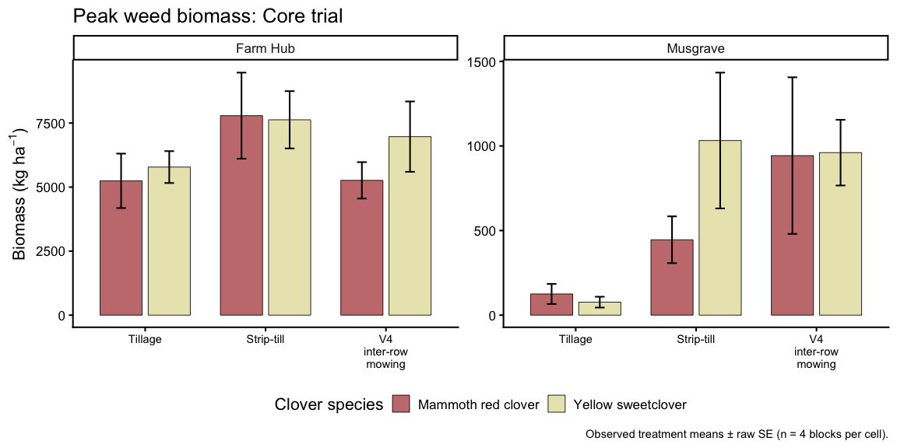<!-- -->

``` r
save_figure(core_weed_fig, "core_peak_weed_biomass.png", 12, 6)
```

### Core trial: legume biomass

``` r
core_legume_fig <- biomass_figure(core_summary, "peak_legume_biomass_kg_ha",
                                 "Legume biomass: Core trial")
print(core_legume_fig)
```

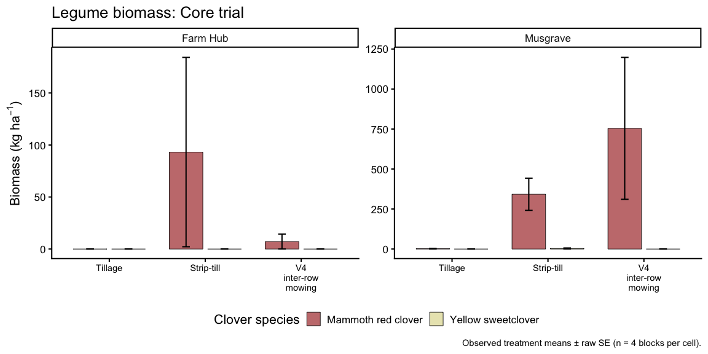<!-- -->

``` r
save_figure(core_legume_fig, "core_peak_legume_biomass.png", 12, 6)
```

### Musgrave mowing trial: peak weed biomass

``` r
tool_weed_fig <- biomass_figure(tool_summary, "peak_weed_biomass_kg_ha",
                               "Peak weed biomass: Musgrave mowing trial", FALSE)
print(tool_weed_fig)
```

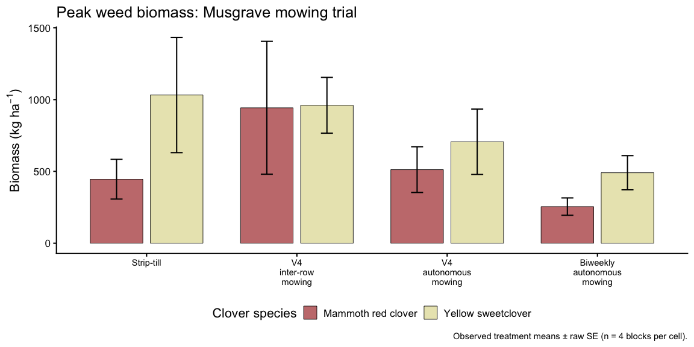<!-- -->

``` r
save_figure(tool_weed_fig, "musgrave_tool_peak_weed_biomass.png", 12, 6)
```

### Musgrave mowing trial: legume biomass

``` r
tool_legume_fig <- biomass_figure(tool_summary, "peak_legume_biomass_kg_ha",
                                 "Legume biomass: Musgrave mowing trial", FALSE)
print(tool_legume_fig)
```

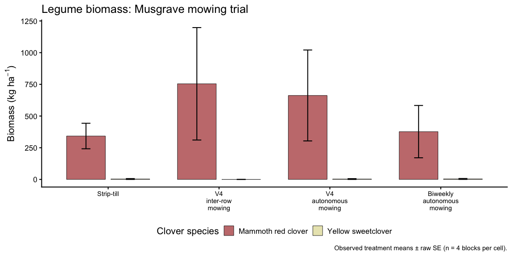<!-- -->

``` r
save_figure(tool_legume_fig, "musgrave_tool_peak_legume_biomass.png", 12, 6)
```

## Mixed models

One initial model is fitted for each response × trial combination (four
total). Weed biomass is modeled with a log-Gaussian LMM. Legume biomass
has many exact zeros and is modeled with a Tweedie GLMM (`1 < p < 2`,
log link). These are **initial** models, subject to diagnostics.

The core weed analysis retains all 48 observations for descriptive
statistics, but excludes one below-detection-limit observation (Musgrave
plot 310, `<0.01 g`, represented as 0.1 kg ha^-1) for the preliminary
log-Gaussian inference model. The original 48-observation model is
retained as a sensitivity check; both models led to the same conclusions
for the tested effects. The three-way location × species × management
interaction was also examined using an ML likelihood-ratio test and was
not supported (p = 0.487). The reduced two-way-interaction model is
retained.

Because legume biomass has near-complete zeros in some combinations, its
preliminary model is deliberately additive; species × management
interactions can be considered if supported later. Random intercepts
represent blocks and species whole plots nested within blocks. The
identifiers `block_id` and `whole_plot_id` are unique across locations;
therefore `(1 | block_id) + (1 | whole_plot_id)` specifies the intended
nesting without needing to repeat the block identifier in the whole-plot
term.

``` r
core_weed_model <- lmerTest::lmer(
  log(peak_weed_biomass_kg_ha) ~
    location * clover_species + location * management +
    clover_species * management +
    (1 | block_id) + (1 | whole_plot_id), data = core)
core_weed_sensitivity_data <- core |>
  filter(!peak_weed_biomass_g_0_5m2_below_detection)
stopifnot(nrow(core_weed_sensitivity_data) == 47)
core_weed_reference <- update(core_weed_model,
                              data = core_weed_sensitivity_data)
tool_weed_model <- lmerTest::lmer(
  log(peak_weed_biomass_kg_ha) ~ clover_species * management +
    (1 | block_id) + (1 | whole_plot_id), data = tool)
core_legume_model <- glmmTMB::glmmTMB(
  peak_legume_biomass_kg_ha ~ location + clover_species + management +
    (1 | block_id) + (1 | whole_plot_id),
  family = glmmTMB::tweedie(link = "log"), data = core)
tool_legume_model <- glmmTMB::glmmTMB(
  peak_legume_biomass_kg_ha ~ clover_species + management +
    (1 | block_id) + (1 | whole_plot_id),
  family = glmmTMB::tweedie(link = "log"), data = tool)
```

## Core trial: weed biomass

### Diagnostics

The reference analysis uses 47 observations; the original 48-observation
model is retained above for sensitivity comparison. Model diagnostics
refer to the 47-observation reference fit.

``` r
show_diagnostics(core_weed_reference)
```

    ## Convergence/covariance checks passed: TRUE 
    ## Linear mixed model fit by REML. t-tests use Satterthwaite's method [
    ## lmerModLmerTest]
    ## Formula: log(peak_weed_biomass_kg_ha) ~ location * clover_species + location *  
    ##     management + clover_species * management + (1 | block_id) +  
    ##     (1 | whole_plot_id)
    ##    Data: core_weed_sensitivity_data
    ## 
    ## REML criterion at convergence: 86.2
    ## 
    ## Scaled residuals: 
    ##      Min       1Q   Median       3Q      Max 
    ## -1.93468 -0.36768  0.07071  0.42360  1.82868 
    ## 
    ## Random effects:
    ##  Groups        Name        Variance Std.Dev.
    ##  whole_plot_id (Intercept) 0.06543  0.2558  
    ##  block_id      (Intercept) 0.06878  0.2623  
    ##  Residual                  0.28824  0.5369  
    ## Number of obs: 47, groups:  whole_plot_id, 16; block_id, 8
    ## 
    ## Fixed effects:
    ##                                                                Estimate
    ## (Intercept)                                                     8.54392
    ## locationMusgrave                                               -4.32155
    ## clover_speciesYellow sweetclover                                0.03852
    ## managementStrip-till                                            0.21778
    ## managementV4 inter-row mowing                                   0.04911
    ## locationMusgrave:clover_speciesYellow sweetclover               0.29472
    ## locationMusgrave:managementStrip-till                           1.62965
    ## locationMusgrave:managementV4 inter-row mowing                  2.16184
    ## clover_speciesYellow sweetclover:managementStrip-till           0.22174
    ## clover_speciesYellow sweetclover:managementV4 inter-row mowing  0.08285
    ##                                                                Std. Error
    ## (Intercept)                                                       0.30719
    ## locationMusgrave                                                  0.40772
    ## clover_speciesYellow sweetclover                                  0.36311
    ## managementStrip-till                                              0.33137
    ## managementV4 inter-row mowing                                     0.33137
    ## locationMusgrave:clover_speciesYellow sweetclover                 0.40566
    ## locationMusgrave:managementStrip-till                             0.38857
    ## locationMusgrave:managementV4 inter-row mowing                    0.38857
    ## clover_speciesYellow sweetclover:managementStrip-till             0.38857
    ## clover_speciesYellow sweetclover:managementV4 inter-row mowing    0.38857
    ##                                                                      df t value
    ## (Intercept)                                                    24.74438  27.813
    ## locationMusgrave                                               20.73823 -10.599
    ## clover_speciesYellow sweetclover                               14.42948   0.106
    ## managementStrip-till                                           25.33993   0.657
    ## managementV4 inter-row mowing                                  25.33993   0.148
    ## locationMusgrave:clover_speciesYellow sweetclover               6.18628   0.727
    ## locationMusgrave:managementStrip-till                          25.60171   4.194
    ## locationMusgrave:managementV4 inter-row mowing                 25.60171   5.564
    ## clover_speciesYellow sweetclover:managementStrip-till          25.60171   0.571
    ## clover_speciesYellow sweetclover:managementV4 inter-row mowing 25.60171   0.213
    ##                                                                Pr(>|t|)    
    ## (Intercept)                                                     < 2e-16 ***
    ## locationMusgrave                                               7.94e-10 ***
    ## clover_speciesYellow sweetclover                               0.916968    
    ## managementStrip-till                                           0.516973    
    ## managementV4 inter-row mowing                                  0.883362    
    ## locationMusgrave:clover_speciesYellow sweetclover              0.494088    
    ## locationMusgrave:managementStrip-till                          0.000289 ***
    ## locationMusgrave:managementV4 inter-row mowing                 8.06e-06 ***
    ## clover_speciesYellow sweetclover:managementStrip-till          0.573211    
    ## clover_speciesYellow sweetclover:managementV4 inter-row mowing 0.832845    
    ## ---
    ## Signif. codes:  0 '***' 0.001 '**' 0.01 '*' 0.05 '.' 0.1 ' ' 1
    ## 
    ## Correlation of Fixed Effects:
    ##             (Intr) lctnMs clv_Ys mngmS- mV4i-m lM:_Ys lcM:S- lM:Vim c_Ys:S
    ## locatnMsgrv -0.664                                                        
    ## clvr_spcsYs -0.591  0.293                                                 
    ## mngmntStrp- -0.542  0.284  0.318                                          
    ## mngmntV4i-m -0.542  0.284  0.318  0.508                                   
    ## lctnMsg:_Ys  0.312 -0.470 -0.528  0.017  0.017                            
    ## lctnMsgr:S-  0.321 -0.484 -0.032 -0.586 -0.306 -0.029                     
    ## lctnM:V4i-m  0.321 -0.484 -0.032 -0.306 -0.586 -0.029  0.523              
    ## clvr_sYs:S-  0.321 -0.029 -0.543 -0.586 -0.306 -0.029  0.045  0.045       
    ## cl_Ys:V4i-m  0.321 -0.029 -0.543 -0.306 -0.586 -0.029  0.045  0.045  0.523
    ##  Groups        Name        Std.Dev.
    ##  whole_plot_id (Intercept) 0.25579 
    ##  block_id      (Intercept) 0.26225 
    ##  Residual                  0.53688

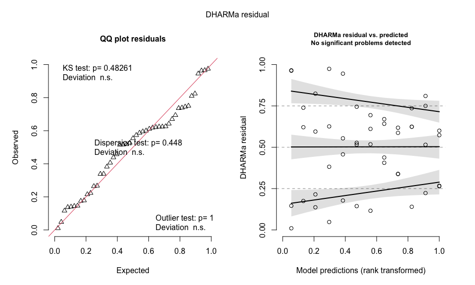<!-- -->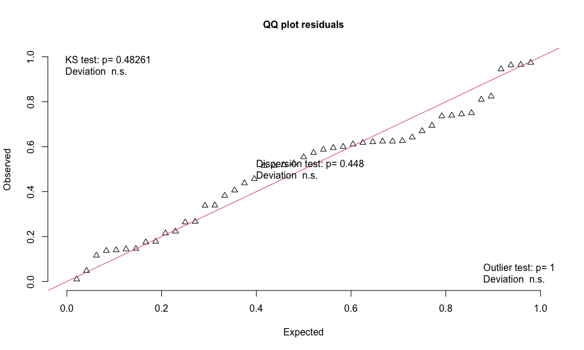<!-- -->

    ## 
    ##  Asymptotic one-sample Kolmogorov-Smirnov test
    ## 
    ## data:  simulationOutput$scaledResiduals
    ## D = 0.12234, p-value = 0.4826
    ## alternative hypothesis: two-sided

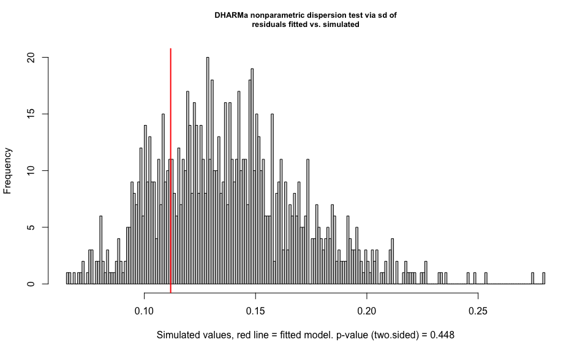<!-- -->

    ## 
    ##  DHARMa nonparametric dispersion test via sd of residuals fitted vs.
    ##  simulated
    ## 
    ## data:  simulationOutput
    ## dispersion = 0.8074, p-value = 0.448
    ## alternative hypothesis: two.sided

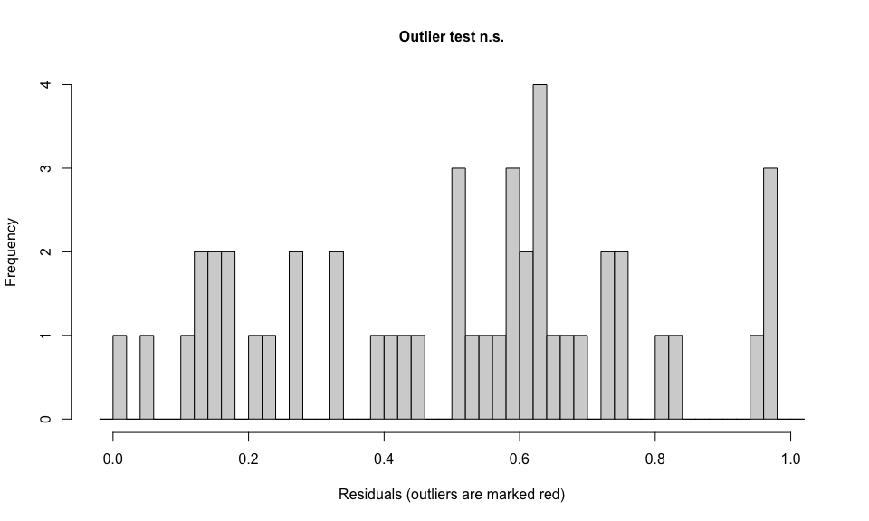<!-- -->

    ## 
    ##  DHARMa outlier test based on exact binomial test with approximate
    ##  expectations
    ## 
    ## data:  sim
    ## outliers at both margin(s) = 0, observations = 47, p-value = 1
    ## alternative hypothesis: true probability of success is not equal to 0.001998002
    ## 95 percent confidence interval:
    ##  0.00000000 0.07548573
    ## sample estimates:
    ## frequency of outliers (expected: 0.001998001998002 ) 
    ##                                                    0

### ANOVA and within-location management comparisons

The location × management interaction is significant. Consequently,
management contrasts are evaluated **within location**, averaged across
clover species. Comparisons are unadjusted Fisher LSD-style
(`adjust = "none"`) and use Satterthwaite degrees of freedom. Contrasts
are estimated on the log scale; raw arithmetic treatment means ± SE are
reported in the descriptive figures.

``` r
core_weed_anova <- as.data.frame(anova(core_weed_reference, type = 2,
                                       ddf = "Satterthwaite"))
core_weed_anova$term <- rownames(core_weed_anova)
rownames(core_weed_anova) <- NULL
core_weed_anova <- core_weed_anova[, c("term", setdiff(names(core_weed_anova), "term"))]
knitr::kable(core_weed_anova, digits = 4,
             caption = "Core weed biomass: Type II tests (47 observations)")
```

| term                      |  Sum Sq | Mean Sq | NumDF |   DenDF |  F value | Pr(\>F) |
|:--------------------------|--------:|--------:|------:|--------:|---------:|--------:|
| location                  | 31.7468 | 31.7468 |     1 |  6.0109 | 110.1385 |  0.0000 |
| clover_species            |  0.5750 |  0.5750 |     1 |  6.1663 |   1.9950 |  0.2062 |
| management                | 12.4165 |  6.2083 |     2 | 25.4181 |  21.5382 |  0.0000 |
| location:clover_species   |  0.1521 |  0.1521 |     1 |  6.1863 |   0.5278 |  0.4941 |
| location:management       |  9.5778 |  4.7889 |     2 | 25.4621 |  16.6141 |  0.0000 |
| clover_species:management |  0.0967 |  0.0484 |     2 | 25.4621 |   0.1678 |  0.8464 |

Core weed biomass: Type II tests (47 observations)

``` r
write_table(core_weed_anova, "core_weed_anova.csv")

core_weed_emm <- emmeans::emmeans(core_weed_reference,
                                  ~ management | location,
                                  lmer.df = "satterthwaite")
core_weed_contrasts <- as.data.frame(summary(
  pairs(core_weed_emm, adjust = "none"),
  infer = c(TRUE, TRUE), adjust = "none"))
knitr::kable(core_weed_contrasts, digits = 3,
             caption = "Core weed biomass: unadjusted management comparisons within location (log scale)")
```

| contrast | location | estimate | SE | df | lower.CL | upper.CL | t.ratio | p.value |
|:---|:---|---:|---:|---:|---:|---:|---:|---:|
| Tillage - (Strip-till) | Farm Hub | -0.329 | 0.268 | 25.203 | -0.881 | 0.224 | -1.224 | 0.232 |
| Tillage - (V4 inter-row mowing) | Farm Hub | -0.091 | 0.268 | 25.203 | -0.643 | 0.462 | -0.337 | 0.739 |
| (Strip-till) - (V4 inter-row mowing) | Farm Hub | 0.238 | 0.268 | 25.203 | -0.315 | 0.791 | 0.887 | 0.383 |
| Tillage - (Strip-till) | Musgrave | -1.958 | 0.281 | 25.967 | -2.536 | -1.381 | -6.971 | 0.000 |
| Tillage - (V4 inter-row mowing) | Musgrave | -2.252 | 0.281 | 25.967 | -2.830 | -1.675 | -8.017 | 0.000 |
| (Strip-till) - (V4 inter-row mowing) | Musgrave | -0.294 | 0.268 | 25.203 | -0.847 | 0.259 | -1.095 | 0.284 |

Core weed biomass: unadjusted management comparisons within location
(log scale)

``` r
write_table(core_weed_contrasts, "core_weed_management_contrasts.csv")
write_table(as.data.frame(summary(core_weed_emm)),
            "core_weed_estimated_means.csv")
```

## Core trial: legume biomass (preliminary)

Legume biomass was sampled during peak weed assessment. Of 48 core-trial
observations, many are zero, reflecting both clover termination in
tilled plots and limited persistence in some strip-till plots. The
preliminary additive Tweedie model estimates effects of location,
species, and management on expected legume biomass. It does not test
their interactions; interpret its effects as exploratory, alongside the
raw treatment summaries.

``` r
show_diagnostics(core_legume_model)
```

    ## Convergence/covariance checks passed: TRUE 
    ##  Family: tweedie  ( log )
    ## Formula:          
    ## peak_legume_biomass_kg_ha ~ location + clover_species + management +  
    ##     (1 | block_id) + (1 | whole_plot_id)
    ## Data: core
    ## 
    ##       AIC       BIC    logLik -2*log(L)  df.resid 
    ##     208.4     225.3     -95.2     190.4        39 
    ## 
    ## Random effects:
    ## 
    ## Conditional model:
    ##  Groups        Name        Variance  Std.Dev. 
    ##  block_id      (Intercept) 5.571e-01 0.7463600
    ##  whole_plot_id (Intercept) 1.192e-08 0.0001092
    ## Number of obs: 48, groups:  block_id, 8; whole_plot_id, 16
    ## 
    ## Dispersion parameter for tweedie family (): 17.9 
    ## 
    ## Conditional model:
    ##                                  Estimate Std. Error z value Pr(>|z|)    
    ## (Intercept)                       -2.6261     1.9910  -1.319 0.187182    
    ## locationMusgrave                   2.6898     0.9245   2.910 0.003619 ** 
    ## clover_speciesYellow sweetclover  -6.2709     1.3788  -4.548 5.41e-06 ***
    ## managementStrip-till               6.0535     1.8327   3.303 0.000957 ***
    ## managementV4 inter-row mowing      6.1128     1.8156   3.367 0.000760 ***
    ## ---
    ## Signif. codes:  0 '***' 0.001 '**' 0.01 '*' 0.05 '.' 0.1 ' ' 1
    ## 
    ## Conditional model:
    ##  Groups        Name        Std.Dev.  
    ##  block_id      (Intercept) 0.74635998
    ##  whole_plot_id (Intercept) 0.00010919

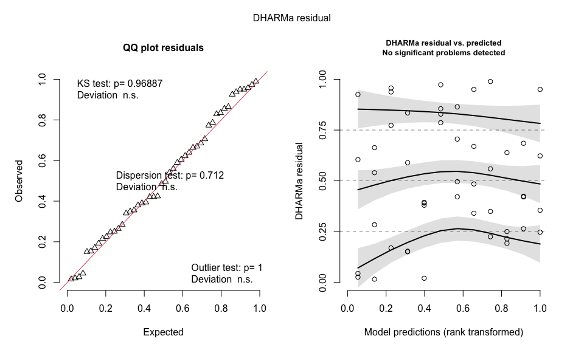<!-- -->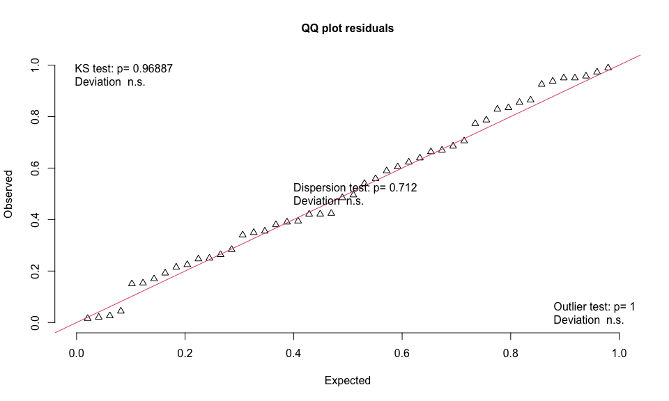<!-- -->

    ## 
    ##  Asymptotic one-sample Kolmogorov-Smirnov test
    ## 
    ## data:  simulationOutput$scaledResiduals
    ## D = 0.071004, p-value = 0.9689
    ## alternative hypothesis: two-sided

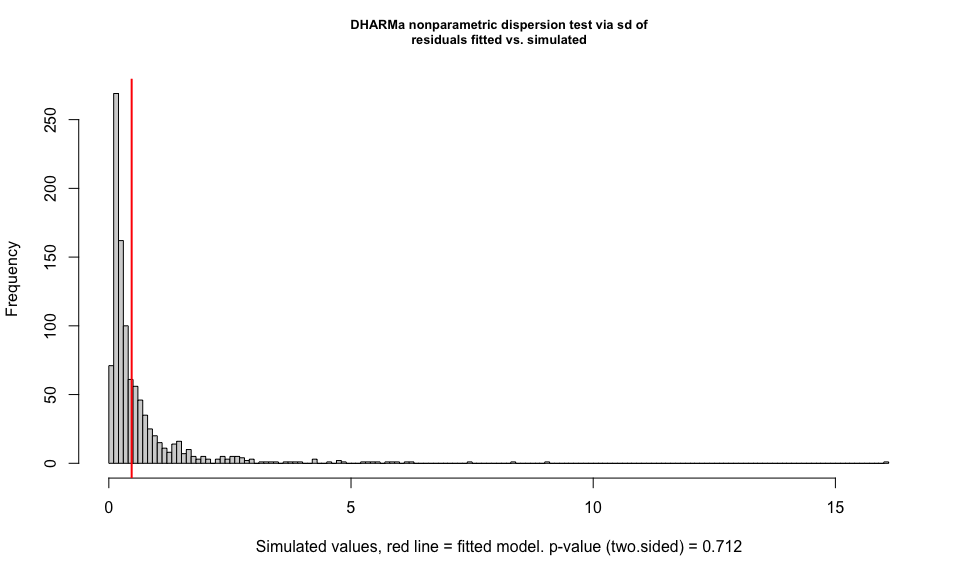<!-- -->

    ## 
    ##  DHARMa nonparametric dispersion test via sd of residuals fitted vs.
    ##  simulated
    ## 
    ## data:  simulationOutput
    ## dispersion = 0.73495, p-value = 0.712
    ## alternative hypothesis: two.sided

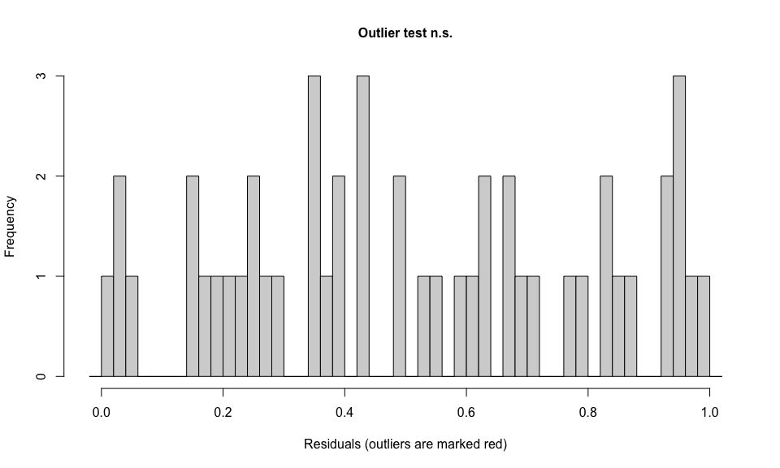<!-- -->

    ## 
    ##  DHARMa outlier test based on exact binomial test with approximate
    ##  expectations
    ## 
    ## data:  sim
    ## outliers at both margin(s) = 0, observations = 48, p-value = 1
    ## alternative hypothesis: true probability of success is not equal to 0.001998002
    ## 95 percent confidence interval:
    ##  0.00000000 0.07397279
    ## sample estimates:
    ## frequency of outliers (expected: 0.001998001998002 ) 
    ##                                                    0

``` r
if (!requireNamespace("car", quietly = TRUE)) stop("Install 'car' for Tweedie tests")
if (model_ok(core_legume_model)) {
  core_legume_anova <- as.data.frame(car::Anova(core_legume_model, type = 2))
  core_legume_anova$term <- rownames(core_legume_anova)
  rownames(core_legume_anova) <- NULL
  core_legume_anova <- core_legume_anova[, c("term", setdiff(names(core_legume_anova), "term"))]
  knitr::kable(core_legume_anova, digits = 3,
               caption = "Core legume biomass: preliminary Type II Wald tests")
  write_table(core_legume_anova, "core_legume_anova.csv")
} else {
  cat("Tweedie model inference withheld pending diagnostic review.\n")
}
```

The preliminary model indicates differences by location, clover species,
and management. The management result is expected to be strongly
influenced by the tilled reference, where clover was intentionally
terminated. No post-hoc treatment letters are assigned to this
zero-heavy response.

## Musgrave mowing trial: weed biomass (preliminary)

The full split-plot model converges but is singular because the
whole-plot variance is estimated as zero. This is flagged for review
rather than silently removing a random effect or automatically reporting
treatment p-values.

``` r
show_diagnostics(tool_weed_model)
```

    ## Convergence/covariance checks passed: FALSE 
    ## Linear mixed model fit by REML. t-tests use Satterthwaite's method [
    ## lmerModLmerTest]
    ## Formula: log(peak_weed_biomass_kg_ha) ~ clover_species * management +  
    ##     (1 | block_id) + (1 | whole_plot_id)
    ##    Data: tool
    ## 
    ## REML criterion at convergence: 61
    ## 
    ## Scaled residuals: 
    ##      Min       1Q   Median       3Q      Max 
    ## -1.72402 -0.58446  0.06387  0.46204  1.86138 
    ## 
    ## Random effects:
    ##  Groups        Name        Variance Std.Dev.
    ##  whole_plot_id (Intercept) 0.0000   0.0000  
    ##  block_id      (Intercept) 0.1281   0.3580  
    ##  Residual                  0.3999   0.6324  
    ## Number of obs: 32, groups:  whole_plot_id, 8; block_id, 4
    ## 
    ## Fixed effects:
    ##                                                                       Estimate
    ## (Intercept)                                                            5.95425
    ## clover_speciesYellow sweetclover                                       0.78608
    ## managementV4 inter-row mowing                                          0.53177
    ## managementV4 autonomous mowing                                         0.11345
    ## managementBiweekly autonomous mowing                                  -0.55682
    ## clover_speciesYellow sweetclover:managementV4 inter-row mowing        -0.47540
    ## clover_speciesYellow sweetclover:managementV4 autonomous mowing       -0.55457
    ## clover_speciesYellow sweetclover:managementBiweekly autonomous mowing -0.08073
    ##                                                                       Std. Error
    ## (Intercept)                                                              0.36335
    ## clover_speciesYellow sweetclover                                         0.44718
    ## managementV4 inter-row mowing                                            0.44718
    ## managementV4 autonomous mowing                                           0.44718
    ## managementBiweekly autonomous mowing                                     0.44718
    ## clover_speciesYellow sweetclover:managementV4 inter-row mowing           0.63241
    ## clover_speciesYellow sweetclover:managementV4 autonomous mowing          0.63241
    ## clover_speciesYellow sweetclover:managementBiweekly autonomous mowing    0.63241
    ##                                                                             df
    ## (Intercept)                                                           16.99549
    ## clover_speciesYellow sweetclover                                      21.00000
    ## managementV4 inter-row mowing                                         21.00000
    ## managementV4 autonomous mowing                                        21.00000
    ## managementBiweekly autonomous mowing                                  21.00000
    ## clover_speciesYellow sweetclover:managementV4 inter-row mowing        21.00000
    ## clover_speciesYellow sweetclover:managementV4 autonomous mowing       21.00000
    ## clover_speciesYellow sweetclover:managementBiweekly autonomous mowing 21.00000
    ##                                                                       t value
    ## (Intercept)                                                            16.387
    ## clover_speciesYellow sweetclover                                        1.758
    ## managementV4 inter-row mowing                                           1.189
    ## managementV4 autonomous mowing                                          0.254
    ## managementBiweekly autonomous mowing                                   -1.245
    ## clover_speciesYellow sweetclover:managementV4 inter-row mowing         -0.752
    ## clover_speciesYellow sweetclover:managementV4 autonomous mowing        -0.877
    ## clover_speciesYellow sweetclover:managementBiweekly autonomous mowing  -0.128
    ##                                                                       Pr(>|t|)
    ## (Intercept)                                                           7.58e-12
    ## clover_speciesYellow sweetclover                                        0.0933
    ## managementV4 inter-row mowing                                           0.2477
    ## managementV4 autonomous mowing                                          0.8022
    ## managementBiweekly autonomous mowing                                    0.2268
    ## clover_speciesYellow sweetclover:managementV4 inter-row mowing          0.4606
    ## clover_speciesYellow sweetclover:managementV4 autonomous mowing         0.3905
    ## clover_speciesYellow sweetclover:managementBiweekly autonomous mowing   0.8996
    ##                                                                          
    ## (Intercept)                                                           ***
    ## clover_speciesYellow sweetclover                                      .  
    ## managementV4 inter-row mowing                                            
    ## managementV4 autonomous mowing                                           
    ## managementBiweekly autonomous mowing                                     
    ## clover_speciesYellow sweetclover:managementV4 inter-row mowing           
    ## clover_speciesYellow sweetclover:managementV4 autonomous mowing          
    ## clover_speciesYellow sweetclover:managementBiweekly autonomous mowing    
    ## ---
    ## Signif. codes:  0 '***' 0.001 '**' 0.01 '*' 0.05 '.' 0.1 ' ' 1
    ## 
    ## Correlation of Fixed Effects:
    ##             (Intr) clv_Ys mV4i-m mnV4am mngBam c_Ysim c_Ys:Vam
    ## clvr_spcsYs -0.615                                            
    ## mngmntV4i-m -0.615  0.500                                     
    ## mngmntV4atm -0.615  0.500  0.500                              
    ## mngmntBwkam -0.615  0.500  0.500  0.500                       
    ## cl_Ys:V4i-m  0.435 -0.707 -0.707 -0.354 -0.354                
    ## clv_Ys:V4am  0.435 -0.707 -0.354 -0.707 -0.354  0.500         
    ## clvr_Ys:Bam  0.435 -0.707 -0.354 -0.354 -0.707  0.500  0.500  
    ## optimizer (nloptwrap) convergence code: 0 (OK)
    ## boundary (singular) fit: see help('isSingular')
    ## 
    ##  Groups        Name        Std.Dev.
    ##  whole_plot_id (Intercept) 0.00000 
    ##  block_id      (Intercept) 0.35796 
    ##  Residual                  0.63241

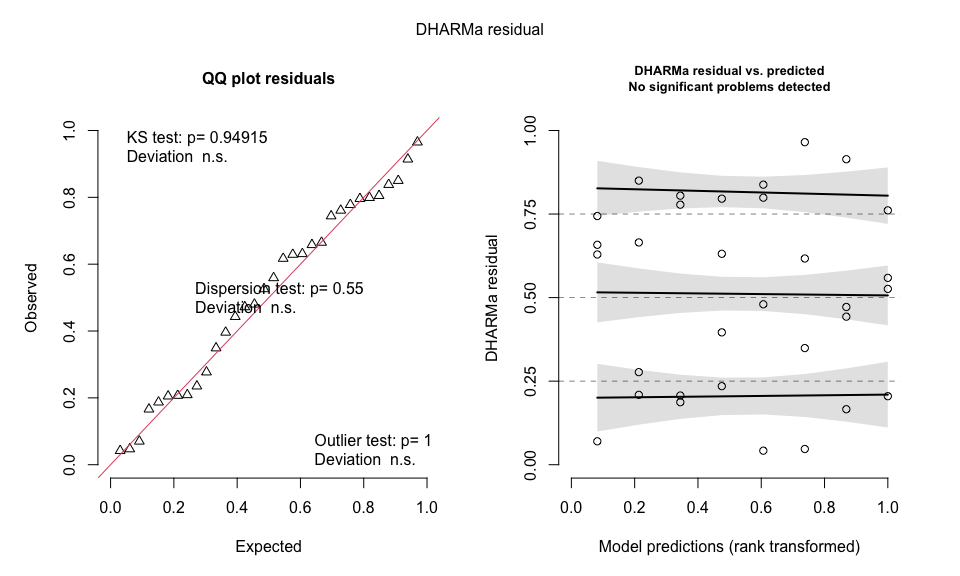<!-- -->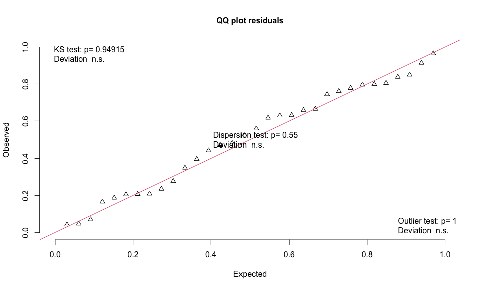<!-- -->

    ## 
    ##  Exact one-sample Kolmogorov-Smirnov test
    ## 
    ## data:  simulationOutput$scaledResiduals
    ## D = 0.0875, p-value = 0.9492
    ## alternative hypothesis: two-sided

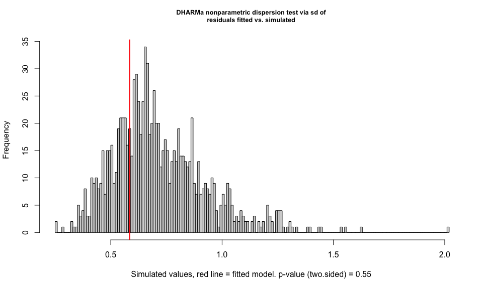<!-- -->

    ## 
    ##  DHARMa nonparametric dispersion test via sd of residuals fitted vs.
    ##  simulated
    ## 
    ## data:  simulationOutput
    ## dispersion = 0.81764, p-value = 0.55
    ## alternative hypothesis: two.sided

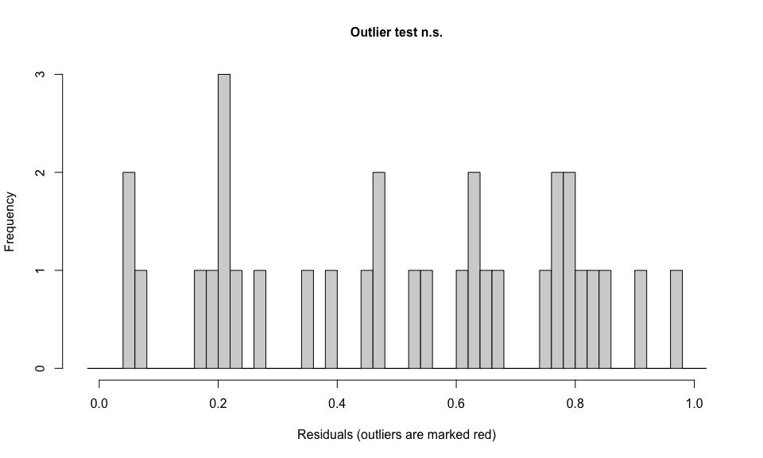<!-- -->

    ## 
    ##  DHARMa outlier test based on exact binomial test with approximate
    ##  expectations
    ## 
    ## data:  sim
    ## outliers at both margin(s) = 0, observations = 32, p-value = 1
    ## alternative hypothesis: true probability of success is not equal to 0.001998002
    ## 95 percent confidence interval:
    ##  0.0000000 0.1088812
    ## sample estimates:
    ## frequency of outliers (expected: 0.001998001998002 ) 
    ##                                                    0

``` r
cat("Singular fit:", lme4::isSingular(tool_weed_model), "\n")
```

    ## Singular fit: TRUE

``` r
cat("Inferential tests deferred pending random-effects review.\n")
```

    ## Inferential tests deferred pending random-effects review.

## Musgrave mowing trial: legume biomass (preliminary)

All four treatments retain the strip-till system; none deliberately
terminate the entire clover understory. The Tweedie model assesses
species and mowing management additively. Its results should be
interpreted cautiously because yellow sweetclover biomass was near zero
in most plots.

``` r
show_diagnostics(tool_legume_model)
```

    ## Convergence/covariance checks passed: TRUE 
    ##  Family: tweedie  ( log )
    ## Formula:          
    ## peak_legume_biomass_kg_ha ~ clover_species + management + (1 |  
    ##     block_id) + (1 | whole_plot_id)
    ## Data: tool
    ## 
    ##       AIC       BIC    logLik -2*log(L)  df.resid 
    ##     296.1     309.3    -139.1     278.1        23 
    ## 
    ## Random effects:
    ## 
    ## Conditional model:
    ##  Groups        Name        Variance Std.Dev.
    ##  block_id      (Intercept) 0.2062   0.4541  
    ##  whole_plot_id (Intercept) 0.1993   0.4464  
    ## Number of obs: 32, groups:  block_id, 4; whole_plot_id, 8
    ## 
    ## Dispersion parameter for tweedie family (): 7.81 
    ## 
    ## Conditional model:
    ##                                      Estimate Std. Error z value Pr(>|z|)    
    ## (Intercept)                            5.8559     0.4538  12.905  < 2e-16 ***
    ## clover_speciesYellow sweetclover      -5.0930     0.6612  -7.703 1.33e-14 ***
    ## managementV4 inter-row mowing          0.3780     0.4387   0.862    0.389    
    ## managementV4 autonomous mowing         0.3500     0.4358   0.803    0.422    
    ## managementBiweekly autonomous mowing  -0.1155     0.4683  -0.247    0.805    
    ## ---
    ## Signif. codes:  0 '***' 0.001 '**' 0.01 '*' 0.05 '.' 0.1 ' ' 1
    ## 
    ## Conditional model:
    ##  Groups        Name        Std.Dev.
    ##  block_id      (Intercept) 0.45407 
    ##  whole_plot_id (Intercept) 0.44640

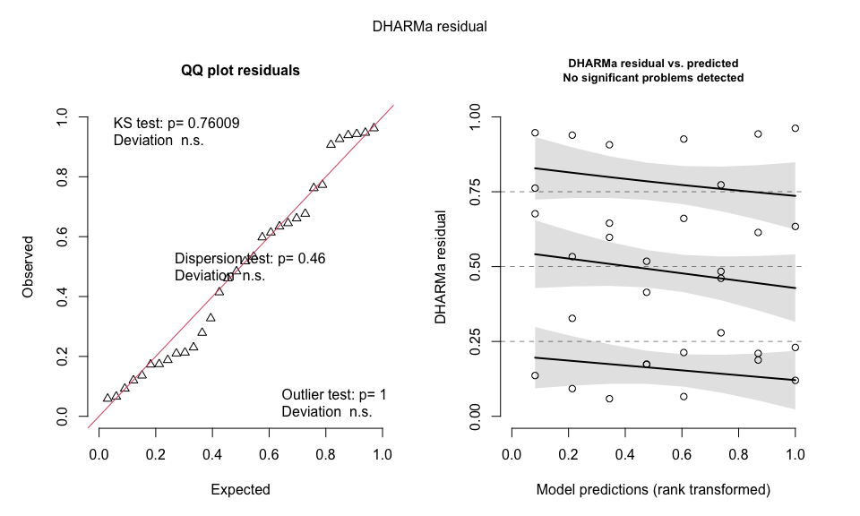<!-- -->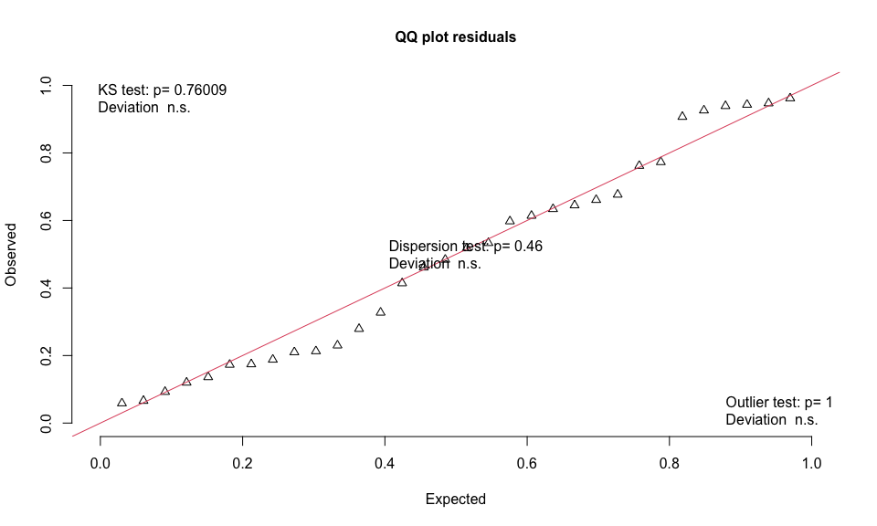<!-- -->

    ## 
    ##  Exact one-sample Kolmogorov-Smirnov test
    ## 
    ## data:  simulationOutput$scaledResiduals
    ## D = 0.11375, p-value = 0.7601
    ## alternative hypothesis: two-sided

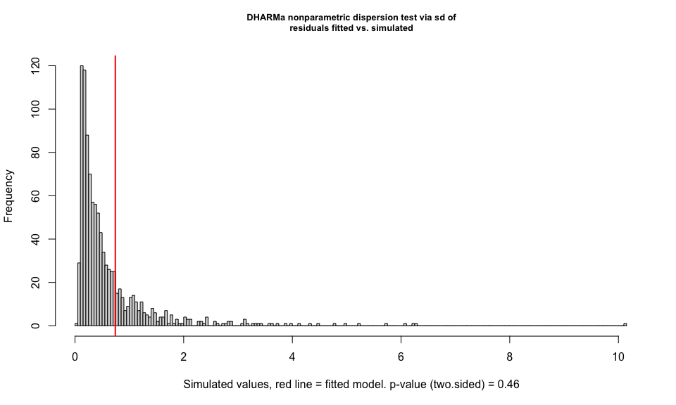<!-- -->

    ## 
    ##  DHARMa nonparametric dispersion test via sd of residuals fitted vs.
    ##  simulated
    ## 
    ## data:  simulationOutput
    ## dispersion = 1.1885, p-value = 0.46
    ## alternative hypothesis: two.sided

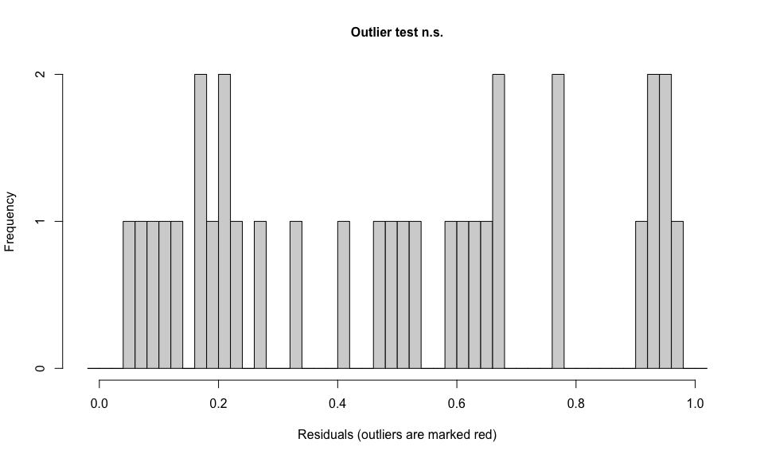<!-- -->

    ## 
    ##  DHARMa outlier test based on exact binomial test with approximate
    ##  expectations
    ## 
    ## data:  sim
    ## outliers at both margin(s) = 0, observations = 32, p-value = 1
    ## alternative hypothesis: true probability of success is not equal to 0.001998002
    ## 95 percent confidence interval:
    ##  0.0000000 0.1088812
    ## sample estimates:
    ## frequency of outliers (expected: 0.001998001998002 ) 
    ##                                                    0

``` r
if (model_ok(tool_legume_model)) {
  tool_legume_anova <- as.data.frame(car::Anova(tool_legume_model, type = 2))
  tool_legume_anova$term <- rownames(tool_legume_anova)
  rownames(tool_legume_anova) <- NULL
  tool_legume_anova <- tool_legume_anova[, c("term", setdiff(names(tool_legume_anova), "term"))]
  knitr::kable(tool_legume_anova, digits = 3,
               caption = "Musgrave legume biomass: preliminary Type II Wald tests")
  write_table(tool_legume_anova, "musgrave_mowing_legume_anova.csv")
} else {
  cat("Tweedie model inference withheld pending diagnostic review.\n")
}
```

The preliminary model indicates a species effect, with much greater
retained biomass under mammoth red clover, but no detected overall
effect of mowing management. This is not evidence that mowing strategies
are equivalent. The descriptive figure and zero counts remain the
clearest summary for now; we do not perform additional pairwise tests or
assign significance letters.

## Interpretation notes

- Core and tool results share Musgrave observations; they are
  complementary.
- Blocks and whole plots are distinct experimental units, not
  interchangeable subplot replicates.
- In the core trial, legume zeros after Tillage reflect intended clover
  removal; zeros in strip-till treatments may reflect loss of
  persistence.
- Inspect diagnostics before retaining models, reporting formal
  conclusions, or adding model-based lowercase significance letters to
  raw-mean figures.
- Wisconsin requires updating design validation and reviewing the model
  structure.

## Session information

``` r
sessionInfo()
```

    ## R version 4.5.2 (2025-10-31)
    ## Platform: aarch64-apple-darwin20
    ## Running under: macOS 27.2
    ## 
    ## Matrix products: default
    ## BLAS:   /System/Library/Frameworks/Accelerate.framework/Versions/A/Frameworks/vecLib.framework/Versions/A/libBLAS.dylib 
    ## LAPACK: /Library/Frameworks/R.framework/Versions/4.5-arm64/Resources/lib/libRlapack.dylib;  LAPACK version 3.12.1
    ## 
    ## locale:
    ## [1] en_US.UTF-8/en_US.UTF-8/en_US.UTF-8/C/en_US.UTF-8/en_US.UTF-8
    ## 
    ## time zone: America/New_York
    ## tzcode source: internal
    ## 
    ## attached base packages:
    ## [1] stats     graphics  grDevices utils     datasets  methods   base     
    ## 
    ## other attached packages:
    ##  [1] DHARMa_0.4.7     emmeans_1.11.2-8 glmmTMB_1.1.15.2 lmerTest_3.1-3  
    ##  [5] lme4_1.1-37      Matrix_1.7-4     knitr_1.50       ggplot2_4.0.0   
    ##  [9] tidyr_1.3.1      dplyr_1.1.4      here_1.0.2      
    ## 
    ## loaded via a namespace (and not attached):
    ##  [1] tidyselect_1.2.1    farver_2.1.2        S7_0.2.0           
    ##  [4] fastmap_1.2.0       TH.data_1.1-4       promises_1.4.0     
    ##  [7] digest_0.6.37       estimability_1.5.1  mime_0.13          
    ## [10] lifecycle_1.0.4     survival_3.8-3      magrittr_2.0.4     
    ## [13] compiler_4.5.2      rlang_1.1.6         tools_4.5.2        
    ## [16] yaml_2.3.10         labeling_0.4.3      plyr_1.8.9         
    ## [19] RColorBrewer_1.1-3  gap.datasets_0.0.6  abind_1.4-8        
    ## [22] multcomp_1.4-29     withr_3.0.2         purrr_1.1.0        
    ## [25] numDeriv_2016.8-1.1 grid_4.5.2          xtable_1.8-4       
    ## [28] scales_1.4.0        iterators_1.0.14    MASS_7.3-65        
    ## [31] cli_3.6.5           mvtnorm_1.3-3       rmarkdown_2.30     
    ## [34] ragg_1.5.0          reformulas_0.4.4    generics_0.1.4     
    ## [37] otel_0.2.0          rstudioapi_0.17.1   minqa_1.2.8        
    ## [40] splines_4.5.2       parallel_4.5.2      vctrs_0.6.5        
    ## [43] boot_1.3-32         sandwich_3.1-1      carData_3.0-5      
    ## [46] car_3.1-3           Formula_1.2-5       qgam_2.0.0         
    ## [49] RTMB_2.0            systemfonts_1.3.1   foreach_1.5.2      
    ## [52] gap_1.6             glue_1.8.0          nloptr_2.2.1       
    ## [55] codetools_0.2-20    gtable_0.3.6        later_1.4.4        
    ## [58] tibble_3.3.0        pillar_1.11.1       htmltools_0.5.8.1  
    ## [61] R6_2.6.1            TMB_1.9.25          textshaping_1.0.4  
    ## [64] Rdpack_2.6.4        doParallel_1.0.17   rprojroot_2.1.1    
    ## [67] evaluate_1.0.5      shiny_1.11.1        lattice_0.22-7     
    ## [70] rbibutils_2.3       httpuv_1.6.16       Rcpp_1.1.0         
    ## [73] coda_0.19-4.1       nlme_3.1-168        mgcv_1.9-3         
    ## [76] xfun_0.61           zoo_1.8-14          pkgconfig_2.0.3
