Yellow Mammoth: Spring Weed and Legume Biomass
================
Sustainable Cropping Systems Lab
2026-11-05

- [Purpose and experimental context](#purpose-and-experimental-context)
- [Import and validation](#import-and-validation)
- [Whole-plot spring biomass
  summaries](#whole-plot-spring-biomass-summaries)
- [Descriptive figures](#descriptive-figures)
- [Mixed models: location and clover
  species](#mixed-models-location-and-clover-species)
- [Model diagnostics](#model-diagnostics)
  - [Spring legume biomass](#spring-legume-biomass)
  - [Spring weed biomass](#spring-weed-biomass)
  - [Residual plots](#residual-plots)
- [Species comparisons within
  locations](#species-comparisons-within-locations)
  - [Spring legume biomass](#spring-legume-biomass-1)
  - [Spring weed biomass](#spring-weed-biomass-1)
- [Final species figures with lowercase
  letters](#final-species-figures-with-lowercase-letters)
- [Baseline variability across blocks and
  subplots](#baseline-variability-across-blocks-and-subplots)
- [Interpretation notes](#interpretation-notes)
- [Session information](#session-information)

## Purpose and experimental context

Characterize spring weed and legume biomass **before management
treatments were implemented**. Clover species was assigned to whole
plots in a split-plot RCBD with four blocks per location. Musgrave has
five subsequently assigned management subplots per whole plot; Farm Hub
has three. All available spring observations are retained, but
management assignments are **not** interpreted as treatment effects.
Spring–peak relationships are intentionally outside this analysis.

## Import and validation

``` r
data_path <- here("data", "processed", "combined_processed.rds")
stopifnot(file.exists(data_path))
dat <- readRDS(data_path)

required <- c("location", "year", "block", "plot_id", "block_id",
              "whole_plot_id", "clover_species", "management",
              "spring_weed_biomass_kg_ha", "spring_legume_biomass_kg_ha")
missing_columns <- setdiff(required, names(dat))
if (length(missing_columns)) stop("Missing columns: ", paste(missing_columns, collapse = ", "))
if (anyDuplicated(dat$plot_id)) stop("Duplicate plot_id values detected.")
if (anyNA(dat[c("location", "block_id", "whole_plot_id", "clover_species")]))
  stop("Missing design identifiers.")
if (any(!is.finite(dat$spring_weed_biomass_kg_ha[!is.na(dat$spring_weed_biomass_kg_ha)]) |
        dat$spring_weed_biomass_kg_ha[!is.na(dat$spring_weed_biomass_kg_ha)] < 0) ||
    any(!is.finite(dat$spring_legume_biomass_kg_ha[!is.na(dat$spring_legume_biomass_kg_ha)]) |
        dat$spring_legume_biomass_kg_ha[!is.na(dat$spring_legume_biomass_kg_ha)] < 0))
  stop("Spring biomass contains negative or non-finite recorded values.")

# Add a row here when incorporating another location.
expected_design <- tibble::tibble(
  location_code = c("farmhub", "musgrave"),
  location_label = c("Farm Hub", "Musgrave"),
  n_blocks = c(4L, 4L),
  n_subplots = c(3L, 5L)
)
if (anyNA(dat[c("spring_weed_biomass_kg_ha", "spring_legume_biomass_kg_ha")]))
  stop("Complete spring biomass observations are required.")
if (!setequal(unique(dat$location), expected_design$location_code))
  stop("Locations do not match expected_design.")

dat <- dat |>
  mutate(location = factor(location, levels = expected_design$location_code,
                           labels = expected_design$location_label),
         clover_species = factor(as.character(clover_species),
                                 levels = names(species_colors)))
if (anyNA(dat$location) || anyNA(dat$clover_species))
  stop("Unexpected location or clover species. Check factor levels.")

design_counts <- dat |>
  group_by(location, year, block_id, clover_species, whole_plot_id) |>
  summarise(n_subplots = n(),
            n_spring_weed = sum(!is.na(spring_weed_biomass_kg_ha)),
            n_spring_legume = sum(!is.na(spring_legume_biomass_kg_ha)),
            .groups = "drop")

expected_subplots <- expected_design$n_subplots[
  match(as.character(design_counts$location), expected_design$location_label)]
if (any(design_counts$n_subplots != expected_subplots))
  stop("Unexpected subplot count within a whole plot.")
block_counts <- design_counts |>
  group_by(location, year) |>
  summarise(n_blocks = n_distinct(block_id), .groups = "drop")
if (any(block_counts$n_blocks != expected_design$n_blocks[
    match(as.character(block_counts$location), expected_design$location_label)]))
  stop("Unexpected number of blocks per location and year.")
species_counts <- design_counts |>
  count(location, year, block_id, clover_species)
if (any(species_counts$n != 1L) ||
    nrow(species_counts) != sum(block_counts$n_blocks) * length(species_colors))
  stop("Each block must contain one whole plot of each clover species.")
if (any(design_counts |>
        count(whole_plot_id) |>
        pull(n) != 1)) stop("A whole-plot identifier spans multiple design groups.")

knitr::kable(design_counts, caption = "Whole-plot structure and spring observations")
```

| location | year | block_id | clover_species | whole_plot_id | n_subplots | n_spring_weed | n_spring_legume |
|:---|---:|:---|:---|:---|---:|---:|---:|
| Farm Hub | 2026 | farmhub_2026_1 | Mammoth red clover | farmhub_2026_1_MRC | 3 | 3 | 3 |
| Farm Hub | 2026 | farmhub_2026_1 | Yellow sweetclover | farmhub_2026_1_YBSC | 3 | 3 | 3 |
| Farm Hub | 2026 | farmhub_2026_2 | Mammoth red clover | farmhub_2026_2_MRC | 3 | 3 | 3 |
| Farm Hub | 2026 | farmhub_2026_2 | Yellow sweetclover | farmhub_2026_2_YBSC | 3 | 3 | 3 |
| Farm Hub | 2026 | farmhub_2026_3 | Mammoth red clover | farmhub_2026_3_MRC | 3 | 3 | 3 |
| Farm Hub | 2026 | farmhub_2026_3 | Yellow sweetclover | farmhub_2026_3_YBSC | 3 | 3 | 3 |
| Farm Hub | 2026 | farmhub_2026_4 | Mammoth red clover | farmhub_2026_4_MRC | 3 | 3 | 3 |
| Farm Hub | 2026 | farmhub_2026_4 | Yellow sweetclover | farmhub_2026_4_YBSC | 3 | 3 | 3 |
| Musgrave | 2026 | musgrave_2026_1 | Mammoth red clover | musgrave_2026_1_MRC | 5 | 5 | 5 |
| Musgrave | 2026 | musgrave_2026_1 | Yellow sweetclover | musgrave_2026_1_YBSC | 5 | 5 | 5 |
| Musgrave | 2026 | musgrave_2026_2 | Mammoth red clover | musgrave_2026_2_MRC | 5 | 5 | 5 |
| Musgrave | 2026 | musgrave_2026_2 | Yellow sweetclover | musgrave_2026_2_YBSC | 5 | 5 | 5 |
| Musgrave | 2026 | musgrave_2026_3 | Mammoth red clover | musgrave_2026_3_MRC | 5 | 5 | 5 |
| Musgrave | 2026 | musgrave_2026_3 | Yellow sweetclover | musgrave_2026_3_YBSC | 5 | 5 | 5 |
| Musgrave | 2026 | musgrave_2026_4 | Mammoth red clover | musgrave_2026_4_MRC | 5 | 5 | 5 |
| Musgrave | 2026 | musgrave_2026_4 | Yellow sweetclover | musgrave_2026_4_YBSC | 5 | 5 | 5 |

Whole-plot structure and spring observations

``` r
write_table(design_counts, "spring_biomass_design_counts.csv")
```

The whole-plot identifier is constructed from location, year, block, and
species in `data_preparation.Rmd` and has been verified against the
field randomization maps. When Wisconsin data are incorporated, add its
location label, block count, and subplot count to `expected_design`.

## Whole-plot spring biomass summaries

First average the observed subplots within each clover whole plot. Each
of the four whole plots per species and location then contributes
**one** observation to species-level means and SE. This avoids treating
the three or five subplots as independent replicates of clover species.

``` r
whole_plot <- dat |>
  group_by(location, year, block_id, whole_plot_id, clover_species) |>
  summarise(
    spring_weed_biomass_kg_ha = if (all(is.na(spring_weed_biomass_kg_ha)))
      NA_real_ else mean(spring_weed_biomass_kg_ha, na.rm = TRUE),
    spring_legume_biomass_kg_ha = if (all(is.na(spring_legume_biomass_kg_ha)))
      NA_real_ else mean(spring_legume_biomass_kg_ha, na.rm = TRUE),
    n_subplots = n(), .groups = "drop")

spring_long <- whole_plot |>
  pivot_longer(cols = c(spring_weed_biomass_kg_ha,
                        spring_legume_biomass_kg_ha),
               names_to = "biomass_type", values_to = "biomass_kg_ha") |>
  mutate(biomass_type = factor(biomass_type,
    levels = c("spring_legume_biomass_kg_ha", "spring_weed_biomass_kg_ha"),
    labels = c("Spring legume biomass", "Spring weed biomass")))

species_summary <- spring_long |>
  group_by(location, clover_species, biomass_type) |>
  summarise(n_whole_plots = sum(!is.na(biomass_kg_ha)),
            mean_kg_ha = if (all(is.na(biomass_kg_ha))) NA_real_ else mean(biomass_kg_ha, na.rm = TRUE),
            sd_kg_ha = sd(biomass_kg_ha, na.rm = TRUE),
            se_kg_ha = sd_kg_ha / sqrt(n_whole_plots), .groups = "drop")

knitr::kable(species_summary, digits = 1,
             caption = "Raw whole-plot means ± SE (kg ha^-1)")
```

| location | clover_species | biomass_type | n_whole_plots | mean_kg_ha | sd_kg_ha | se_kg_ha |
|:---|:---|:---|---:|---:|---:|---:|
| Farm Hub | Mammoth red clover | Spring legume biomass | 4 | 949.8 | 160.5 | 80.3 |
| Farm Hub | Mammoth red clover | Spring weed biomass | 4 | 238.6 | 75.5 | 37.8 |
| Farm Hub | Yellow sweetclover | Spring legume biomass | 4 | 527.2 | 44.3 | 22.1 |
| Farm Hub | Yellow sweetclover | Spring weed biomass | 4 | 260.8 | 55.7 | 27.8 |
| Musgrave | Mammoth red clover | Spring legume biomass | 4 | 1067.6 | 200.1 | 100.1 |
| Musgrave | Mammoth red clover | Spring weed biomass | 4 | 364.5 | 217.8 | 108.9 |
| Musgrave | Yellow sweetclover | Spring legume biomass | 4 | 1113.1 | 293.9 | 146.9 |
| Musgrave | Yellow sweetclover | Spring weed biomass | 4 | 149.2 | 106.0 | 53.0 |

Raw whole-plot means ± SE (kg ha^-1)

``` r
write_table(whole_plot, "spring_biomass_whole_plot_means.csv")
write_table(species_summary, "spring_biomass_species_summary.csv")
```

## Descriptive figures

Error bars show raw SE among whole-plot means (not subplot SE or
model-based uncertainty). Lowercase letters are added after model
contrasts are calculated below. Individual whole-plot observations
remain available in the tables and block-variability figure.

``` r
species_plot <- function(biomass_label) {
  pdat <- filter(species_summary, biomass_type == biomass_label)
  ggplot(pdat, aes(x = clover_species, y = mean_kg_ha, fill = clover_species)) +
    geom_col(width = 0.65, color = "black", linewidth = 0.3) +
    geom_errorbar(aes(ymin = pmax(0, mean_kg_ha - se_kg_ha),
                      ymax = mean_kg_ha + se_kg_ha), width = 0.17) +
    facet_wrap(~location) +
    scale_fill_manual(values = species_colors, drop = FALSE) +
    scale_x_discrete(labels = c("Mammoth red clover" = "Mammoth red\nclover",
                                "Yellow sweetclover" = "Yellow\nsweetclover")) +
    labs(x = NULL, y = expression("Biomass (kg ha"^{-1}*")"),
         title = biomass_label,
         caption = paste(
           "Bars show observed whole-plot means ± SE (n = 4 per species and location).\n",
           "Lowercase letters: unadjusted model-based Fisher's LSD comparisons within locations."
         )) +
    theme(legend.position = "none",
          axis.text.x = element_text(angle = 0, hjust = 0.5),
          plot.caption = element_text(size = 11, hjust = 0.5,
                                      margin = margin(t = 15)))
}

legume_fig <- species_plot("Spring legume biomass")
weed_fig <- species_plot("Spring weed biomass")
```

## Mixed models: location and clover species

Models use **whole-plot means** as observations. Location and species
are fixed effects, and blocks nested within location are random
intercepts. These models assess species, location, and their
interaction, not management assignments. Because only four blocks are
available per location, interpret model tests cautiously. Significant
location-by-species interactions are followed by species comparisons
within each location, using estimated marginal means.

``` r
fit_spring <- function(response) {
  model_data <- whole_plot |>
    filter(!is.na(.data[[response]])) |>
    mutate(block_id = factor(block_id))
  if (n_distinct(model_data$location) < 2 ||
      n_distinct(model_data$clover_species) < 2)
    stop("Both sites and both species are needed for the proposed model.")
  formula <- as.formula(paste(response,
    "~ location * clover_species + (1 | block_id)"))
  lmerTest::lmer(formula, data = model_data, REML = TRUE)
}

legume_model <- fit_spring("spring_legume_biomass_kg_ha")
weed_model <- fit_spring("spring_weed_biomass_kg_ha")

# Type II tests with Satterthwaite denominator degrees of freedom.
# Interpret main effects alongside the species-by-location interaction.
legume_anova <- as.data.frame(anova(legume_model, type = 2, ddf = "Satterthwaite"))
weed_anova <- as.data.frame(anova(weed_model, type = 2, ddf = "Satterthwaite"))
legume_anova$term <- rownames(legume_anova)
weed_anova$term <- rownames(weed_anova)
knitr::kable(legume_anova, digits = 3, caption = "Spring legume biomass: Type II tests")
```

|  | Sum Sq | Mean Sq | NumDF | DenDF | F value | Pr(\>F) | term |
|:---|---:|---:|---:|---:|---:|---:|:---|
| location | 128629.6 | 128629.6 | 1 | 6 | 8.094 | 0.029 | location |
| clover_species | 142151.6 | 142151.6 | 1 | 6 | 8.945 | 0.024 | clover_species |
| location:clover_species | 219089.5 | 219089.5 | 1 | 6 | 13.786 | 0.010 | location:clover_species |

Spring legume biomass: Type II tests

``` r
knitr::kable(weed_anova, digits = 3, caption = "Spring weed biomass: Type II tests")
```

|  | Sum Sq | Mean Sq | NumDF | DenDF | F value | Pr(\>F) | term |
|:---|---:|---:|---:|---:|---:|---:|:---|
| location | 46.858 | 46.858 | 1 | 6 | 0.007 | 0.934 | location |
| clover_species | 37243.854 | 37243.854 | 1 | 6 | 5.929 | 0.051 | clover_species |
| location:clover_species | 56384.086 | 56384.086 | 1 | 6 | 8.976 | 0.024 | location:clover_species |

Spring weed biomass: Type II tests

``` r
write_table(legume_anova, "spring_legume_biomass_anova.csv")
write_table(weed_anova, "spring_weed_biomass_anova.csv")
```

## Model diagnostics

Convergence, singularity, variance components, conventional residual
plots, and simulation-based checks are reported for **both** models. A
singular fit is flagged rather than automatically treated as invalid.
DHARMa tests are diagnostic aids and should be interpreted alongside the
residual plots, especially with only 16 whole plots.

``` r
check_spring_model <- function(model, location_values) {
  cat("Singular fit:", lme4::isSingular(model), "\n")
  if (length(model@optinfo$conv$lme4$messages)) {
    cat("Convergence messages:\n")
    print(model@optinfo$conv$lme4$messages)
  } else {
    cat("No lme4 convergence messages.\n")
  }
  print(VarCorr(model))
  set.seed(123)
  simulated <- DHARMa::simulateResiduals(model, n = 1000)
  plot(simulated)
  print(DHARMa::testDispersion(simulated))
  print(DHARMa::testUniformity(simulated))
  print(DHARMa::testOutliers(simulated))
  DHARMa::plotResiduals(simulated, form = location_values)
  invisible(simulated)
}
```

### Spring legume biomass

``` r
legume_simulated <- check_spring_model(
  legume_model,
  model.frame(legume_model)$location)
```

    ## Singular fit: FALSE 
    ## No lme4 convergence messages.
    ##  Groups   Name        Std.Dev.
    ##  block_id (Intercept) 150.47  
    ##  Residual             126.06

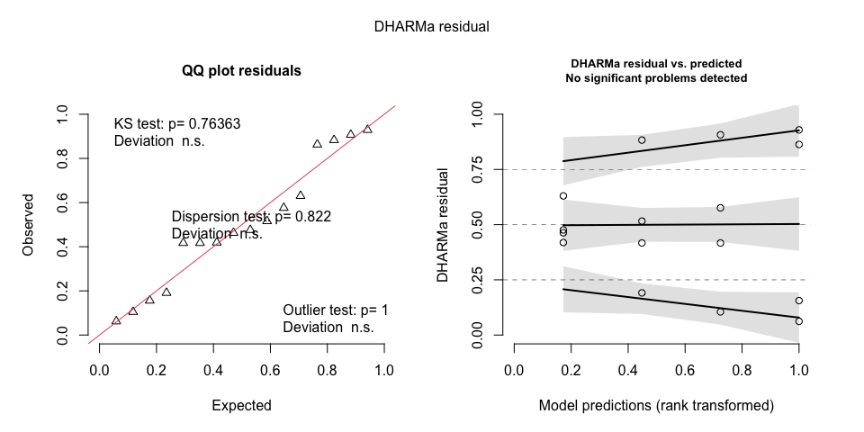<!-- -->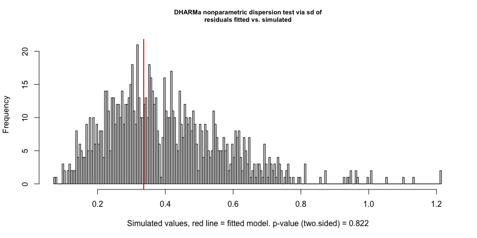<!-- -->

    ## 
    ##  DHARMa nonparametric dispersion test via sd of residuals fitted vs.
    ##  simulated
    ## 
    ## data:  simulationOutput
    ## dispersion = 0.83854, p-value = 0.822
    ## alternative hypothesis: two.sided

<!-- -->

    ## 
    ##  Asymptotic one-sample Kolmogorov-Smirnov test
    ## 
    ## data:  simulationOutput$scaledResiduals
    ## D = 0.167, p-value = 0.7636
    ## alternative hypothesis: two-sided

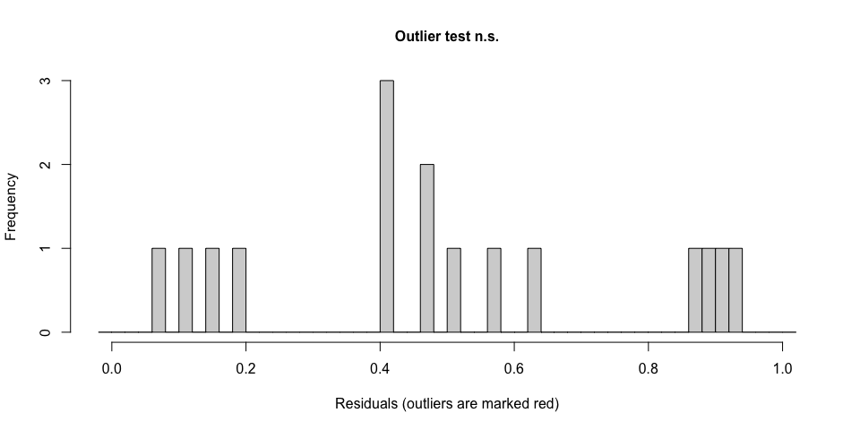<!-- -->

    ## 
    ##  DHARMa outlier test based on exact binomial test with approximate
    ##  expectations
    ## 
    ## data:  simulated
    ## outliers at both margin(s) = 0, observations = 16, p-value = 1
    ## alternative hypothesis: true probability of success is not equal to 0.001998002
    ## 95 percent confidence interval:
    ##  0.0000000 0.2059072
    ## sample estimates:
    ## frequency of outliers (expected: 0.001998001998002 ) 
    ##                                                    0

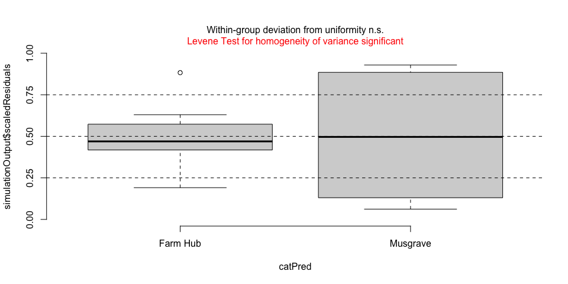<!-- -->

### Spring weed biomass

``` r
weed_simulated <- check_spring_model(
  weed_model,
  model.frame(weed_model)$location)
```

    ## Singular fit: FALSE 
    ## No lme4 convergence messages.
    ##  Groups   Name        Std.Dev.
    ##  block_id (Intercept) 102.915 
    ##  Residual              79.257

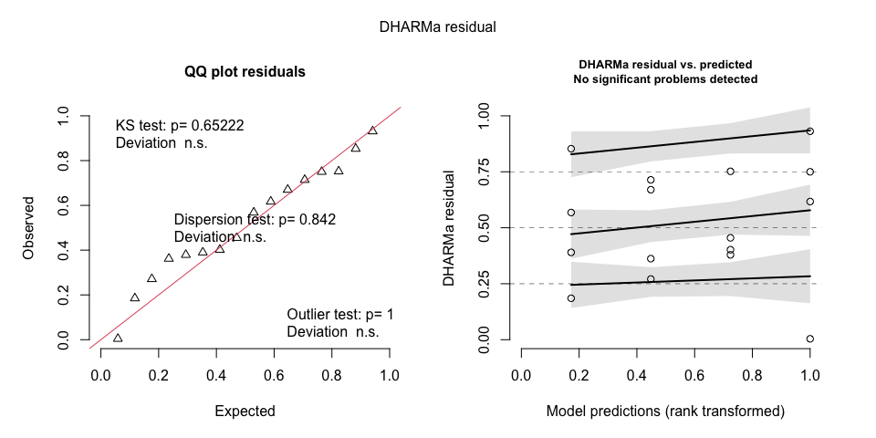<!-- -->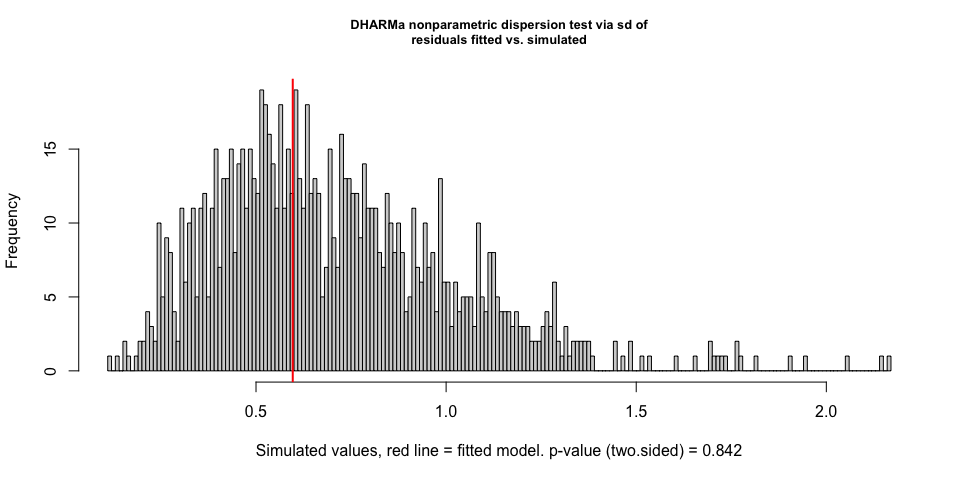<!-- -->

    ## 
    ##  DHARMa nonparametric dispersion test via sd of residuals fitted vs.
    ##  simulated
    ## 
    ## data:  simulationOutput
    ## dispersion = 0.84118, p-value = 0.842
    ## alternative hypothesis: two.sided

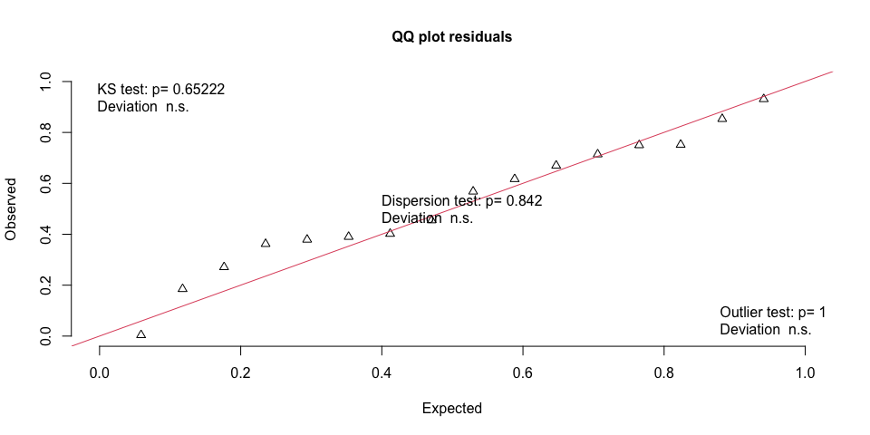<!-- -->

    ## 
    ##  Exact one-sample Kolmogorov-Smirnov test
    ## 
    ## data:  simulationOutput$scaledResiduals
    ## D = 0.1745, p-value = 0.6522
    ## alternative hypothesis: two-sided

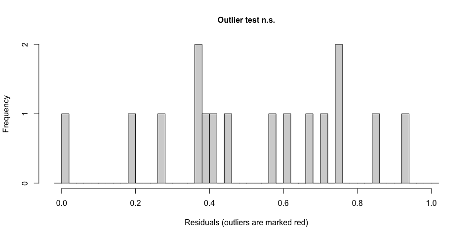<!-- -->

    ## 
    ##  DHARMa outlier test based on exact binomial test with approximate
    ##  expectations
    ## 
    ## data:  simulated
    ## outliers at both margin(s) = 0, observations = 16, p-value = 1
    ## alternative hypothesis: true probability of success is not equal to 0.001998002
    ## 95 percent confidence interval:
    ##  0.0000000 0.2059072
    ## sample estimates:
    ## frequency of outliers (expected: 0.001998001998002 ) 
    ##                                                    0

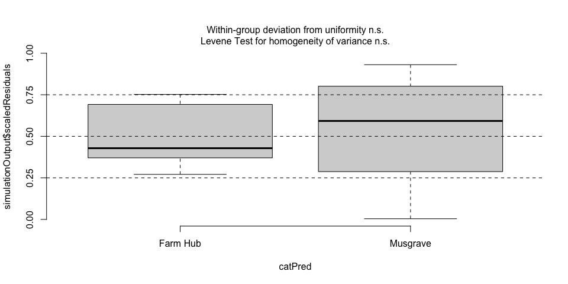<!-- -->

### Residual plots

``` r
diagnostics <- bind_rows(
  data.frame(response = "Spring legume biomass", fitted = fitted(legume_model),
             residual = resid(legume_model)),
  data.frame(response = "Spring weed biomass", fitted = fitted(weed_model),
             residual = resid(weed_model)))
diagnostic_fig <- ggplot(diagnostics, aes(fitted, residual)) +
  geom_hline(yintercept = 0, linetype = "dashed", color = "gray50") +
  geom_point(size = 2.5) + facet_wrap(~response, scales = "free") +
  labs(x = expression("Fitted biomass (kg ha"^{-1}*")"),
       y = expression("Residual (kg ha"^{-1}*")"))
print(diagnostic_fig)
```

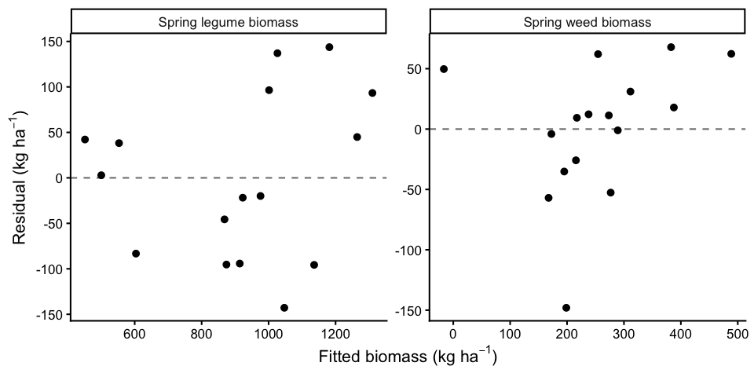<!-- -->

``` r
save_figure(diagnostic_fig, "spring_biomass_model_residuals.png", 10, 5)

qq_fig <- ggplot(diagnostics, aes(sample = residual)) +
  stat_qq(size = 2) + stat_qq_line() +
  facet_wrap(~response, scales = "free") +
  labs(x = "Theoretical quantiles", y = "Sample residual quantiles")
print(qq_fig)
```

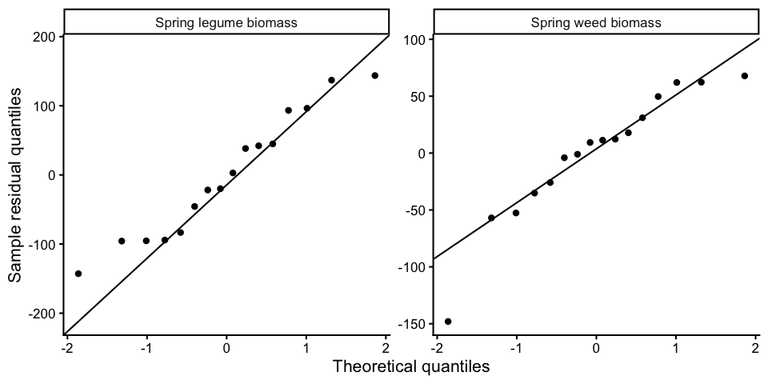<!-- -->

``` r
save_figure(qq_fig, "spring_biomass_residual_qq.png", 10, 5)
```

## Species comparisons within locations

When the location-by-species interaction is significant, test the two
species **within** each location rather than interpreting the species
main effect in isolation. Following the Mowtivation convention, these
are **unadjusted Fisher LSD-style comparisons** from the fitted mixed
model (`adjust = "none"`). No Tukey adjustment is used. There is one
species pair per location, but the two site-specific tests are not
familywise-error controlled. Estimates and 95% confidence intervals
remain on the original kg ha^-1 scale. The contrast is mammoth red
clover minus yellow sweetclover.

``` r
within_location <- function(model, label, filename) {
  emm <- emmeans::emmeans(model, ~ clover_species | location,
                          lmer.df = "satterthwaite")
  comparisons <- emmeans::contrast(emm, method = "pairwise", by = "location")
  contrast_table <- as.data.frame(summary(comparisons,
                                           infer = c(TRUE, TRUE), adjust = "none"))
  cat("\n\n### ", label, "\n\n", sep = "")
  print(knitr::kable(contrast_table, digits = 3))
  write_table(as.data.frame(summary(emm)),
              sub("contrasts", "estimated_means", filename))
  write_table(contrast_table, filename)
  invisible(contrast_table)
}

legume_species_contrasts <- within_location(
  legume_model, "Spring legume biomass", "spring_legume_species_contrasts.csv")
```

### Spring legume biomass

| contrast | location | estimate | SE | df | lower.CL | upper.CL | t.ratio | p.value |
|:---|:---|---:|---:|---:|---:|---:|---:|---:|
| Mammoth red clover - Yellow sweetclover | Farm Hub | 422.55 | 89.14 | 6 | 204.432 | 640.668 | 4.740 | 0.003 |
| Mammoth red clover - Yellow sweetclover | Musgrave | -45.52 | 89.14 | 6 | -263.638 | 172.598 | -0.511 | 0.628 |

``` r
weed_species_contrasts <- within_location(
  weed_model, "Spring weed biomass", "spring_weed_species_contrasts.csv")
```

### Spring weed biomass

| contrast | location | estimate | SE | df | lower.CL | upper.CL | t.ratio | p.value |
|:---|:---|---:|---:|---:|---:|---:|---:|---:|
| Mammoth red clover - Yellow sweetclover | Farm Hub | -22.233 | 56.043 | 6 | -159.366 | 114.899 | -0.397 | 0.705 |
| Mammoth red clover - Yellow sweetclover | Musgrave | 215.220 | 56.043 | 6 | 78.088 | 352.352 | 3.840 | 0.009 |

## Final species figures with lowercase letters

Letters follow the unadjusted, model-based Fisher LSD-style species
contrasts within each location at alpha = 0.05. The higher observed
species mean receives `a`; if the difference is significant, the lower
mean receives `b`, otherwise both receive `a`. Letters are not based on
overlap of raw SE bars. The bar heights and error bars remain raw
whole-plot mean ± SE.

``` r
make_letters <- function(summary_data, contrasts_data) {
  summary_data |>
    left_join(contrasts_data |> select(location, p.value), by = "location") |>
    group_by(location) |>
    mutate(letter = if_else(p.value < 0.05 &
                              mean_kg_ha < max(mean_kg_ha, na.rm = TRUE),
                            "b", "a"),
           label_y = mean_kg_ha + se_kg_ha +
             0.08 * max(mean_kg_ha + se_kg_ha, na.rm = TRUE)) |>
    ungroup()
}

legume_letters <- make_letters(
  filter(species_summary, biomass_type == "Spring legume biomass"),
  legume_species_contrasts)
weed_letters <- make_letters(
  filter(species_summary, biomass_type == "Spring weed biomass"),
  weed_species_contrasts)

legume_fig <- legume_fig +
  geom_text(data = legume_letters, aes(x = clover_species, y = label_y,
                                      label = letter), inherit.aes = FALSE,
            size = 6, fontface = "bold") +
  expand_limits(y = max(legume_letters$label_y) * 1.07)
weed_fig <- weed_fig +
  geom_text(data = weed_letters, aes(x = clover_species, y = label_y,
                                    label = letter), inherit.aes = FALSE,
            size = 6, fontface = "bold") +
  expand_limits(y = max(weed_letters$label_y) * 1.07)

print(legume_fig)
```

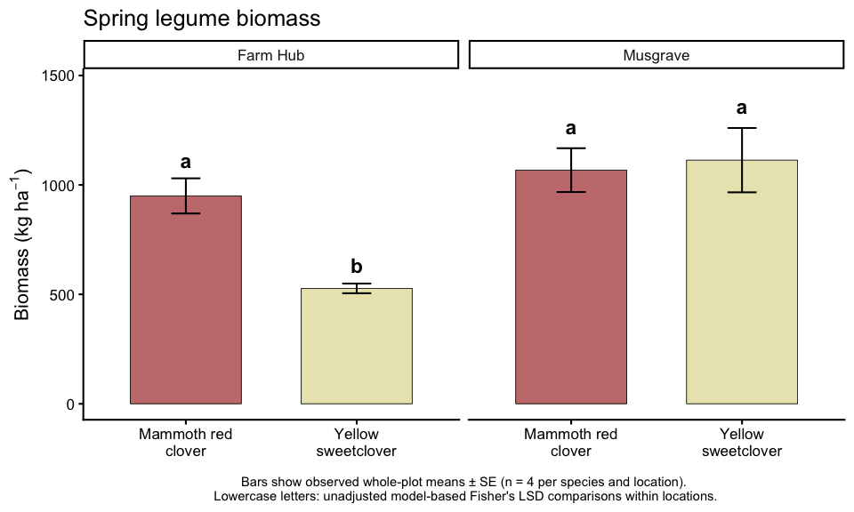<!-- -->

``` r
print(weed_fig)
```

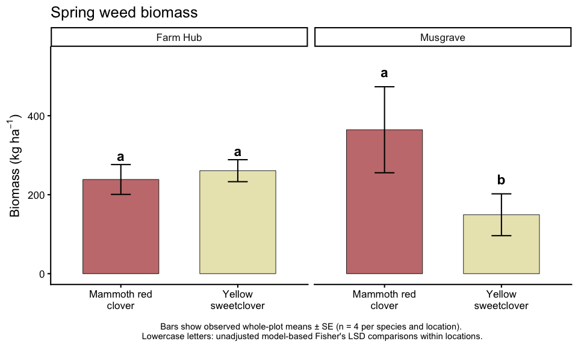<!-- -->

``` r
save_figure(legume_fig, "spring_legume_biomass_by_species_location.png", 10, 6)
save_figure(weed_fig, "spring_weed_biomass_by_species_location.png", 10, 6)
write_table(legume_letters, "spring_legume_species_letters.csv")
write_table(weed_letters, "spring_weed_species_letters.csv")
```

## Baseline variability across blocks and subplots

This is a descriptive check for heterogeneity and unusual starting
conditions. Subplot points are **not** independent clover species
replicates. Management is not used as a predictor because treatment
operations had not begun.

``` r
subplot_long <- dat |>
  select(plot_id, location, block_id, clover_species,
         spring_weed_biomass_kg_ha, spring_legume_biomass_kg_ha) |>
  pivot_longer(starts_with("spring_"), names_to = "biomass_type",
               values_to = "biomass_kg_ha") |>
  mutate(biomass_type = recode(biomass_type,
    spring_weed_biomass_kg_ha = "Spring weed biomass",
    spring_legume_biomass_kg_ha = "Spring legume biomass"),
    block = sub("^.*_", "", block_id))

block_fig <- ggplot(subplot_long,
                    aes(x = factor(block), y = biomass_kg_ha,
                        color = clover_species)) +
  geom_point(position = position_jitterdodge(jitter.width = 0.15,
                                             dodge.width = 0.55), size = 2, alpha = 0.8) +
  facet_grid(biomass_type ~ location, scales = "free_y") +
  scale_color_manual(values = species_colors, drop = FALSE) +
  labs(x = "Block", y = expression("Biomass (kg ha"^{-1}*")"),
       color = "Clover species") +
  theme(legend.position = "bottom")
print(block_fig)
```

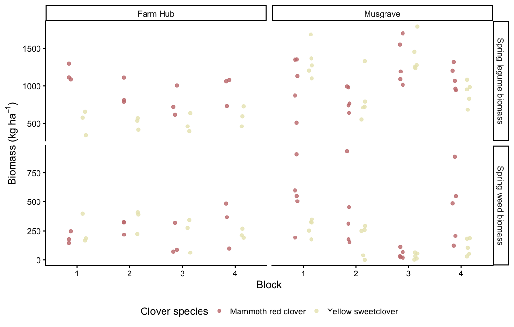<!-- -->

``` r
save_figure(block_fig, "spring_biomass_subplot_variability_by_block.png", 11, 7)

block_summary <- subplot_long |>
  group_by(location, block, clover_species, biomass_type) |>
  summarise(n_subplots = sum(!is.na(biomass_kg_ha)),
            mean_kg_ha = if (all(is.na(biomass_kg_ha))) NA_real_ else mean(biomass_kg_ha, na.rm = TRUE),
            sd_kg_ha = sd(biomass_kg_ha, na.rm = TRUE), .groups = "drop")
knitr::kable(block_summary, digits = 1,
             caption = "Descriptive subplot variability within blocks")
```

| location | block | clover_species | biomass_type | n_subplots | mean_kg_ha | sd_kg_ha |
|:---|:---|:---|:---|---:|---:|---:|
| Farm Hub | 1 | Mammoth red clover | Spring legume biomass | 3 | 1163.4 | 115.4 |
| Farm Hub | 1 | Mammoth red clover | Spring weed biomass | 3 | 189.7 | 52.5 |
| Farm Hub | 1 | Yellow sweetclover | Spring legume biomass | 3 | 520.5 | 162.5 |
| Farm Hub | 1 | Yellow sweetclover | Spring weed biomass | 3 | 250.1 | 129.4 |
| Farm Hub | 2 | Mammoth red clover | Spring legume biomass | 3 | 901.0 | 179.4 |
| Farm Hub | 2 | Mammoth red clover | Spring weed biomass | 3 | 288.1 | 61.1 |
| Farm Hub | 2 | Yellow sweetclover | Spring legume biomass | 3 | 503.1 | 82.1 |
| Farm Hub | 2 | Yellow sweetclover | Spring weed biomass | 3 | 342.5 | 102.7 |
| Farm Hub | 3 | Mammoth red clover | Spring legume biomass | 3 | 778.7 | 203.5 |
| Farm Hub | 3 | Mammoth red clover | Spring weed biomass | 3 | 159.9 | 137.5 |
| Farm Hub | 3 | Yellow sweetclover | Spring legume biomass | 3 | 493.7 | 124.6 |
| Farm Hub | 3 | Yellow sweetclover | Spring weed biomass | 3 | 226.6 | 146.1 |
| Farm Hub | 4 | Mammoth red clover | Spring legume biomass | 3 | 955.9 | 194.9 |
| Farm Hub | 4 | Mammoth red clover | Spring weed biomass | 3 | 316.5 | 197.4 |
| Farm Hub | 4 | Yellow sweetclover | Spring legume biomass | 3 | 591.5 | 134.9 |
| Farm Hub | 4 | Yellow sweetclover | Spring weed biomass | 3 | 224.1 | 40.7 |
| Musgrave | 1 | Mammoth red clover | Spring legume biomass | 5 | 1040.3 | 357.8 |
| Musgrave | 1 | Mammoth red clover | Spring weed biomass | 5 | 550.9 | 255.4 |
| Musgrave | 1 | Yellow sweetclover | Spring legume biomass | 5 | 1325.2 | 224.1 |
| Musgrave | 1 | Yellow sweetclover | Spring weed biomass | 5 | 284.7 | 70.7 |
| Musgrave | 2 | Mammoth red clover | Spring legume biomass | 5 | 822.6 | 157.9 |
| Musgrave | 2 | Mammoth red clover | Spring weed biomass | 5 | 405.6 | 319.2 |
| Musgrave | 2 | Yellow sweetclover | Spring legume biomass | 5 | 819.6 | 297.7 |
| Musgrave | 2 | Yellow sweetclover | Spring weed biomass | 5 | 168.4 | 137.2 |
| Musgrave | 3 | Mammoth red clover | Spring legume biomass | 5 | 1309.4 | 301.3 |
| Musgrave | 3 | Mammoth red clover | Spring weed biomass | 5 | 50.6 | 40.2 |
| Musgrave | 3 | Yellow sweetclover | Spring legume biomass | 5 | 1403.4 | 234.3 |
| Musgrave | 3 | Yellow sweetclover | Spring weed biomass | 5 | 33.2 | 27.3 |
| Musgrave | 4 | Mammoth red clover | Spring legume biomass | 5 | 1097.8 | 161.2 |
| Musgrave | 4 | Mammoth red clover | Spring weed biomass | 5 | 450.6 | 304.0 |
| Musgrave | 4 | Yellow sweetclover | Spring legume biomass | 5 | 904.1 | 155.0 |
| Musgrave | 4 | Yellow sweetclover | Spring weed biomass | 5 | 110.6 | 71.8 |

Descriptive subplot variability within blocks

``` r
write_table(block_summary, "spring_biomass_block_subplots_summary.csv")
```

## Interpretation notes

- Species and location comparisons are based on whole plots, not subplot
  pseudoreplication.
- No effects are attributed to management treatments assigned but not
  yet implemented.
- Species differences in spring biomass reflect conditions following
  clover establishment; they are not necessarily pretreatment covariates
  for species effects.
- Review model residuals before formal interpretation. If assumptions
  are poor, report descriptive results and reassess the model
  separately.
- Peak biomass relationships and potential covariate adjustments are
  deferred.

## Session information

``` r
sessionInfo()
```

    ## R version 4.5.2 (2025-10-31)
    ## Platform: aarch64-apple-darwin20
    ## Running under: macOS 27.2
    ## 
    ## Matrix products: default
    ## BLAS:   /System/Library/Frameworks/Accelerate.framework/Versions/A/Frameworks/vecLib.framework/Versions/A/libBLAS.dylib 
    ## LAPACK: /Library/Frameworks/R.framework/Versions/4.5-arm64/Resources/lib/libRlapack.dylib;  LAPACK version 3.12.1
    ## 
    ## locale:
    ## [1] en_US.UTF-8/en_US.UTF-8/en_US.UTF-8/C/en_US.UTF-8/en_US.UTF-8
    ## 
    ## time zone: America/New_York
    ## tzcode source: internal
    ## 
    ## attached base packages:
    ## [1] stats     graphics  grDevices utils     datasets  methods   base     
    ## 
    ## other attached packages:
    ##  [1] DHARMa_0.4.7     emmeans_1.11.2-8 lmerTest_3.1-3   lme4_1.1-37     
    ##  [5] Matrix_1.7-4     knitr_1.50       ggplot2_4.0.0    tidyr_1.3.1     
    ##  [9] dplyr_1.1.4      here_1.0.2      
    ## 
    ## loaded via a namespace (and not attached):
    ##  [1] gtable_0.3.6        xfun_0.61           lattice_0.22-7     
    ##  [4] numDeriv_2016.8-1.1 vctrs_0.6.5         tools_4.5.2        
    ##  [7] Rdpack_2.6.4        generics_0.1.4      parallel_4.5.2     
    ## [10] sandwich_3.1-1      tibble_3.3.0        pkgconfig_2.0.3    
    ## [13] RColorBrewer_1.1-3  S7_0.2.0            lifecycle_1.0.4    
    ## [16] compiler_4.5.2      farver_2.1.2        textshaping_1.0.4  
    ## [19] gap.datasets_0.0.6  codetools_0.2-20    httpuv_1.6.16      
    ## [22] htmltools_0.5.8.1   yaml_2.3.10         later_1.4.4        
    ## [25] pillar_1.11.1       nloptr_2.2.1        MASS_7.3-65        
    ## [28] reformulas_0.4.4    iterators_1.0.14    boot_1.3-32        
    ## [31] multcomp_1.4-29     foreach_1.5.2       mime_0.13          
    ## [34] nlme_3.1-168        tidyselect_1.2.1    digest_0.6.37      
    ## [37] mvtnorm_1.3-3       purrr_1.1.0         labeling_0.4.3     
    ## [40] splines_4.5.2       rprojroot_2.1.1     fastmap_1.2.0      
    ## [43] grid_4.5.2          cli_3.6.5           magrittr_2.0.4     
    ## [46] survival_3.8-3      TH.data_1.1-4       withr_3.0.2        
    ## [49] promises_1.4.0      scales_1.4.0        estimability_1.5.1 
    ## [52] rmarkdown_2.30      otel_0.2.0          ragg_1.5.0         
    ## [55] zoo_1.8-14          coda_0.19-4.1       shiny_1.11.1       
    ## [58] evaluate_1.0.5      rbibutils_2.3       gap_1.6            
    ## [61] doParallel_1.0.17   mgcv_1.9-3          rlang_1.1.6        
    ## [64] Rcpp_1.1.0          xtable_1.8-4        glue_1.8.0         
    ## [67] qgam_2.0.0          rstudioapi_0.17.1   minqa_1.2.8        
    ## [70] R6_2.6.1            plyr_1.8.9          systemfonts_1.3.1
